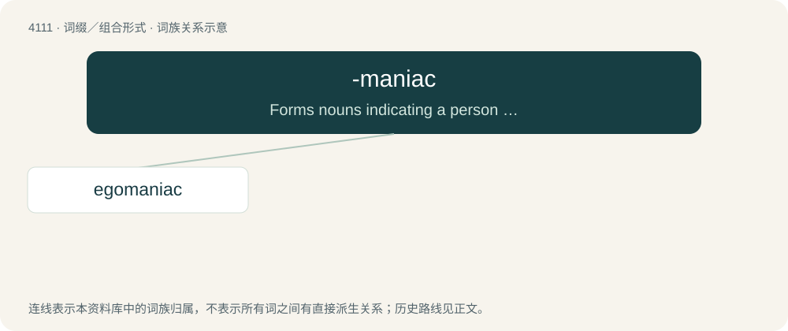

# 4122 · -maniac — Forms nouns indicating a person who experiences a mania (a type of compulsion or obsession).

[总目录](../00_总目录_按常用程度.md)

**类型**：词缀／组合形式　｜　**来源语言**：见词源记录

## 核心含义与来源

- 核心含义：Forms nouns indicating a person who experiences a mania (a type of compulsion or obsession).
- 英文含义：Forms nouns indicating a person who experiences a mania (a type of compulsion or obsession).
- 词形：-maniac

**来源记录 1**（后缀／后置成分；Forms nouns indicating a person who experiences a mania (a type of compulsion or obsession).）

See maniac.

## 词族图

## 单词速览（常用到不常用）

| 单词 | 音标 | 释义 |
|---|---|---|
| [egomaniac](#w-1) | 美 /iɡoʊˈmeɪniæk/ | n. 极端利己主义者 |

## 逐词详解

### 1. egomaniac

**词性**：名词　｜　**音标**：美 /iɡoʊˈmeɪniæk/

**中文释义**：n. 极端利己主义者

**英文义项**：A person obsessed with their own (supposed) importance.

**构词拆分**：ego- + -maniac

**词源与演化**：

From ego- + -maniac.

**例句**：

> He's a raving egomaniac: all he ever talks about is himself and how important he is.

该用例对应义项：A person obsessed with their own (supposed) importance.
