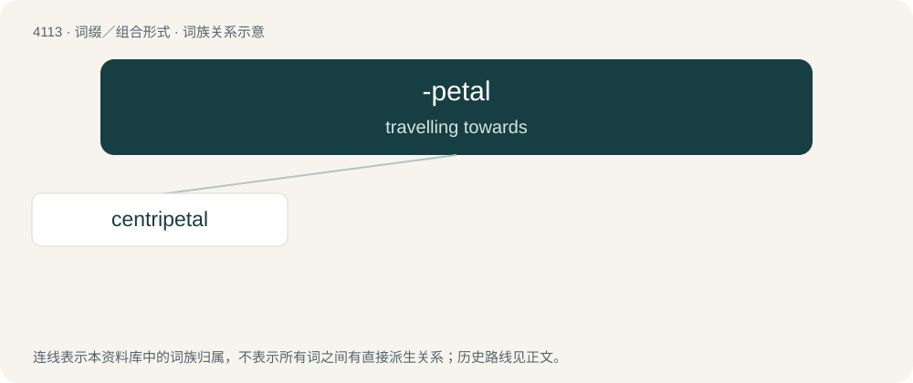

# 4125 · -petal — travelling towards

[总目录](../00_总目录_按常用程度.md)

**类型**：词缀／组合形式　｜　**来源语言**：见词源记录

## 核心含义与来源

- 核心含义：travelling towards
- 英文含义：travelling towards
- 词形：-petal

**来源记录 1**（后缀／后置成分；travelling towards）

Formed from the stem of Latin petō, petere (“seek, aim”), with the suffix -al, from Latin -alis.

## 词族图

## 单词速览（常用到不常用）

| 单词 | 音标 | 释义 |
|---|---|---|
| [centripetal](#w-1) | 英 /ˌsɛn.tɹɪˈpiː.tl̩/；美 /sɛnˈtɹɪp.ə.tl̩/ | a. 向心的；\[医\] 向心的, 向中的, 求中的 |

## 逐词详解

### 1. centripetal

**词性**：形容词　｜　**音标**：英 /ˌsɛn.tɹɪˈpiː.tl̩/；美 /sɛnˈtɹɪp.ə.tl̩/

**中文释义**：a. 向心的；\[医\] 向心的, 向中的, 求中的

**英文义项**：Directed or moving towards a centre. / Directed towards the central nervous system; afferent.

**构词拆分**：centri- + -petal

**词源与演化**：

From New Latin centripetālis coined by Sir Isaac Newton, from Latin centrum (“center”) + petō (“to seek, aim”) + -al. Analysable as centri- + -petal.
