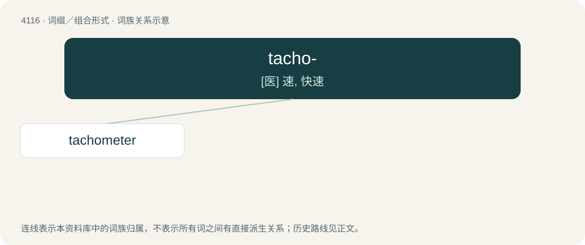

# 4129 · tacho- — \[医\] 速, 快速

[总目录](../00_总目录_按常用程度.md)

**类型**：词缀／组合形式　｜　**来源语言**：见词源记录

## 核心含义与来源

- 核心含义：\[医\] 速, 快速
- 英文含义：speed, velocity
- 词形：tacho-

**来源记录 1**（前缀／前置成分；speed, velocity）

Borrowed from Ancient Greek τάχος (tákhos, “speed”). Compare tachy-, from the same root.

## 词族图

## 单词速览（常用到不常用）

| 单词 | 音标 | 释义 |
|---|---|---|
| [tachometer](#w-1) | /təˈkɒmətə(ɹ)/ | n. 转速计, 流速计；\[医\] 血流速度计 |

## 逐词详解

### 1. tachometer

**词性**：名词　｜　**音标**：/təˈkɒmətə(ɹ)/

**中文释义**：n. 转速计, 流速计；\[医\] 血流速度计

**英文义项**：A device for measuring the revolutions per minute (RPMs) of a revolving shaft, as with the driveshaft of an automobile. / A device for measuring or indicating velocity or speed, as of blood, a river, a machine, etc.

**构词拆分**：tacho- + -meter

**词源与演化**：

From tacho- + -meter.
