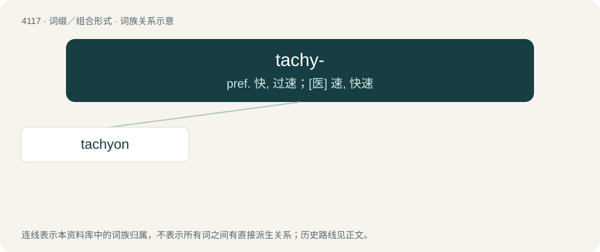

# 4130 · tachy- — pref. 快, 过速；\[医\] 速, 快速

[总目录](../00_总目录_按常用程度.md)

**类型**：词缀／组合形式　｜　**来源语言**：见词源记录

## 核心含义与来源

- 核心含义：pref. 快, 过速；\[医\] 速, 快速
- 英文含义：fast
- 词形：tachy-

**来源记录 1**（前缀／前置成分；fast）

Borrowed from Ancient Greek τᾰχῠ́ς (tăkhŭ́s, “swift”).

## 词族图

## 单词速览（常用到不常用）

| 单词 | 音标 | 释义 |
|---|---|---|
| [tachyon](#w-1) | 英 /ˈtæk.i.ɒn/；美 /ˈtæ.kiˌɑn/ | n. \[核\]超光速粒子 |

## 逐词详解

### 1. tachyon

**词性**：名词　｜　**音标**：英 /ˈtæk.i.ɒn/；美 /ˈtæ.kiˌɑn/

**中文释义**：n. \[核\]超光速粒子

**英文义项**：A hypothetical particle that travels faster than the speed of light. / A flaw in a physical theory that predicts the existence of tachyons or similar paradoxical results. Compare with ghost.

**构词拆分**：tachy- + -on

**词源与演化**：

Formed as: tachy- + -on, from ταχύς (takhús, “swift”, “rapid”). Coined by American physicist Gerald Feinberg in 1967.
