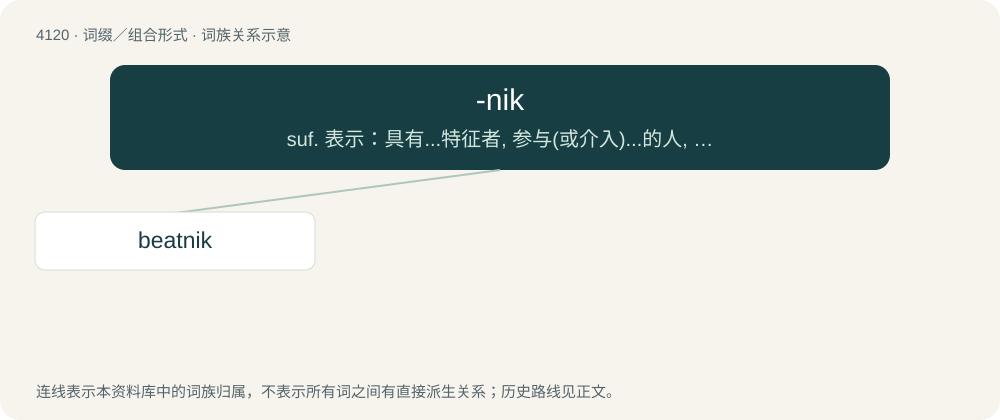

# 4132 · -nik — suf. 表示：具有...特征者, 参与(或介入)...的人, 爱好(或热衷于)...的人：filmnik, peacenik; 具有...特征的东西(尤指卫星、火箭等)

[总目录](../00_总目录_按常用程度.md)

**类型**：词缀／组合形式　｜　**来源语言**：见词源记录

## 核心含义与来源

- 核心含义：suf. 表示：具有...特征者, 参与(或介入)...的人, 爱好(或热衷于)...的人：filmnik, peacenik; 具有...特征的东西(尤指卫星、火箭等)
- 英文含义：Used to form nouns denoting a person who exemplifies, endorses, or is associated with a specified thing or quality, often a particular ideology or preference.
- 词形：-nik

**来源记录 1**（后缀／后置成分；Used to form nouns denoting a person who exemplifies, endorses, or is associated with a specified thing or quality, often a particular ideology or preference.）

From the Slavic suffix represented by Russian -ник (-nik). This suffix experienced a surge in English coinages for nicknames and diminutives after the Soviet launch of the first Sputnik satellite in 1957. Its usage in English is heavily influenced by Yiddish usage of ־ניק (-nik) and similar borrowed words (nogoodnik, nudnik, kibbutznik).

## 词族图

## 单词速览（常用到不常用）

| 单词 | 音标 | 释义 |
|---|---|---|
| [beatnik](#w-1) | /ˈbiːtnɪk/ | n. "垮了的一代"的一员 |

## 逐词详解

### 1. beatnik

**词性**：名词　｜　**音标**：/ˈbiːtnɪk/

**中文释义**：n. "垮了的一代"的一员

**英文义项**：A person who dresses in a manner that is not socially acceptable and is supposed to reject conventional norms of thought and behavior; nonconformist in dress and behavior. / A person associated with the Beat Generation of the 1950s and 1960s or its style.

**构词拆分**：beat (generation) + -nik (“person who exemplifies or endorses something”)

**词源与演化**：

Coined by American columnist Herb Caen in 1958. From beat (generation) + -nik (“person who exemplifies or endorses something”). Compare jazznik. The suffix, a cutesy or ironic use of the Russian suffix -ник (-nik), experienced a surge of use in English coinages for nicknames and diminutives after the 1957 Soviet launch of the Sputnik satellite.
