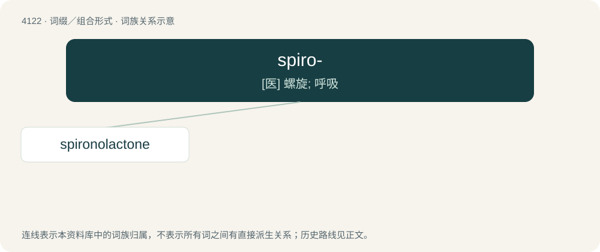

# 4134 · spiro- — \[医\] 螺旋; 呼吸

[总目录](../00_总目录_按常用程度.md)

**类型**：词缀／组合形式　｜　**来源语言**：见词源记录

## 核心含义与来源

- 核心含义：\[医\] 螺旋; 呼吸
- 英文含义：spiral, helix
- 词形：spiro-

**来源记录 1**（前缀／前置成分；spiral, helix）

From Latin spīra + English -o-.

## 词族图

## 单词速览（常用到不常用）

| 单词 | 音标 | 释义 |
|---|---|---|
| [spironolactone](#w-1) | 英 /ˌspʌɪ.ɹən.ə(ʊ)ˈlæk.təʊn/；美 /ˌspaɪ.ɹən.oʊˈlækˌtoʊn/ | n. \[药\]安体舒通,螺内酯,螺旋内酯甾酮(一种利尿药) |

## 逐词详解

### 1. spironolactone

**词性**：名词　｜　**音标**：英 /ˌspʌɪ.ɹən.ə(ʊ)ˈlæk.təʊn/；美 /ˌspaɪ.ɹən.oʊˈlækˌtoʊn/

**中文释义**：n. \[药\]安体舒通,螺内酯,螺旋内酯甾酮(一种利尿药)

**英文义项**：A steroid drug which acts as an antimineralocorticoid (for which purpose it is used in the treatment of certain types of edema and hypertension) and an antiandrogen (for which purpose it is used as part of some types of hormone therapy, especially for transgender women).

**构词拆分**：spiro- + -one + -o- + lactone

**词源与演化**：

From spiro- + -one + -o- + lactone.
