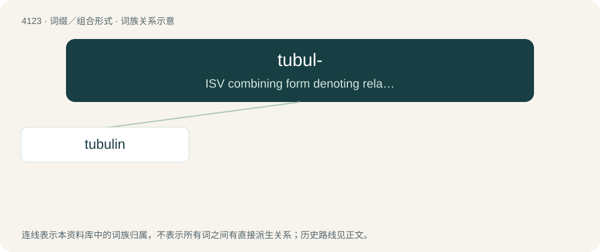

# 4135 · tubul- — ISV combining form denoting relationship to tubules or microtubules

[总目录](../00_总目录_按常用程度.md)

**类型**：词缀／组合形式　｜　**来源语言**：见词源记录

## 核心含义与来源

- 核心含义：ISV combining form denoting relationship to tubules or microtubules
- 英文含义：ISV combining form denoting relationship to tubules or microtubules
- 词形：tubul-

## 词族图

## 单词速览（常用到不常用）

| 单词 | 音标 | 释义 |
|---|---|---|
| [tubulin](#w-1) | /ˈtjuːbjjlin/ | n. \[生化\]微管蛋白 |

## 逐词详解

### 1. tubulin

**词性**：名词　｜　**音标**：/ˈtjuːbjjlin/

**中文释义**：n. \[生化\]微管蛋白

**英文义项**：Any of a group of proteins used as the material for microtubules. / Specifically, the dimer of α-tubulin and β-tubulin.

**构词拆分**：tubule + -in；tubul- + -in

**词源与演化**：

From tubul- + -in.
