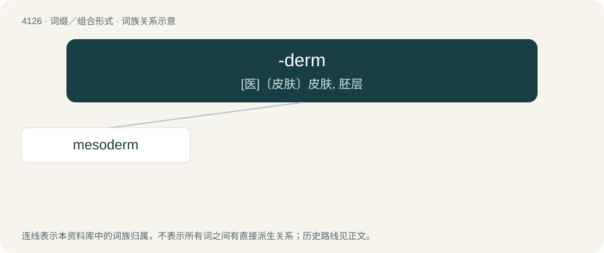

# 4137 · -derm — \[医\]〔皮肤〕皮肤, 胚层

[总目录](../00_总目录_按常用程度.md)

**类型**：词缀／组合形式　｜　**来源语言**：见词源记录

## 核心含义与来源

- 核心含义：\[医\]〔皮肤〕皮肤, 胚层
- 英文含义：skin or covering
- 词形：-derm

**来源记录 1**（后缀／后置成分；skin or covering）

From Ancient Greek δέρμα (dérma, “skin”).

## 词族图

## 单词速览（常用到不常用）

| 单词 | 音标 | 释义 |
|---|---|---|
| [mesoderm](#w-1) | /ˈmesəudəːm/ | n. 中胚层；\[医\] 中胚层 |

## 逐词详解

### 1. mesoderm

**词性**：名词　｜　**音标**：/ˈmesəudəːm/

**中文释义**：n. 中胚层；\[医\] 中胚层

**英文义项**：One of the three tissue layers in the embryo of a metazoan animal, which will produce, through development, many internal organs of the adult, e.g. muscles, spine and the circulatory system.

**构词拆分**：meso- + -derm

**词源与演化**：

From meso- + -derm.
