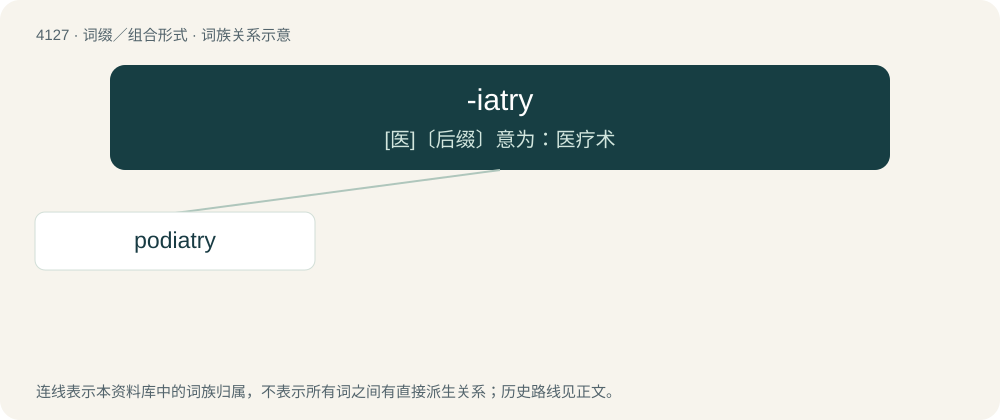

# 4138 · -iatry — \[医\]〔后缀〕意为：医疗术

[总目录](../00_总目录_按常用程度.md)

**类型**：词缀／组合形式　｜　**来源语言**：见词源记录

## 核心含义与来源

- 核心含义：\[医\]〔后缀〕意为：医疗术
- 英文含义：Forms names of specialized fields of medical practice.
- 词形：-iatry

**来源记录 1**（后缀／后置成分；Forms names of specialized fields of medical practice.）

From Ancient Greek ἰατρεία (iatreía, “healing, medical treatment”), from ἰατρός (iatrós, “doctor”).

## 词族图

## 单词速览（常用到不常用）

| 单词 | 音标 | 释义 |
|---|---|---|
| [podiatry](#w-1) | /pəˈdaɪətɹi/ | n. 脚病学；\[医\] \[手\]足医术 |

## 逐词详解

### 1. podiatry

**词性**：名词　｜　**音标**：/pəˈdaɪətɹi/

**中文释义**：n. 脚病学；\[医\] \[手\]足医术

**英文义项**：Chiropody.

**构词拆分**：pod- + -iatry

**词源与演化**：

From pod- + -iatry.
