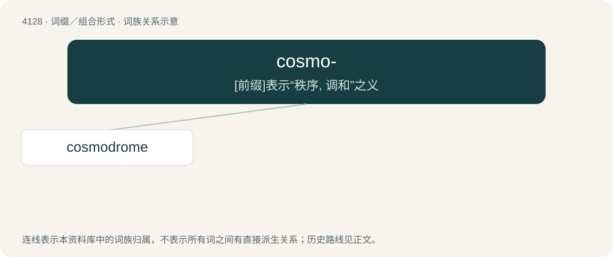

# 4139 · cosmo- — \[前缀\]表示“秩序, 调和”之义

[总目录](../00_总目录_按常用程度.md)

**类型**：词缀／组合形式　｜　**来源语言**：见词源记录

## 核心含义与来源

- 核心含义：\[前缀\]表示“秩序, 调和”之义
- 英文含义：universe, world
- 词形：cosmo-

**来源记录 1**（前缀／前置成分；universe, world）

Derived from Ancient Greek κόσμος (kósmos, “universe”), from Proto-Hellenic \*kónsmos, from Proto-Indo-European \*ḱens-, possibly from \*ḱem-.

## 词族图

## 单词速览（常用到不常用）

| 单词 | 音标 | 释义 |
|---|---|---|
| [cosmodrome](#w-1) | /ˈkɒzmədrəum/ | n. 航天器发射基地 |

## 逐词详解

### 1. cosmodrome

**词性**：名词　｜　**音标**：/ˈkɒzmədrəum/

**中文释义**：n. 航天器发射基地

**英文义项**：A site for launching spacecraft, usually in reference to such Soviet or Russian built sites as the Baikonur, Kazakhstan and Plesetsk, Russia cosmodromes.

**构词拆分**：cosmo- + -drome

**词源与演化**：

From cosmo- + -drome, modelled after aerodrome.

**例句**：

> The Progress 75 spacecraft is scheduled to launch from the Baikonur Cosmodrome in Kazakhstan.
