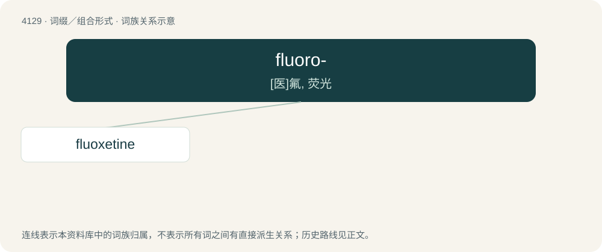

# 4140 · fluoro- — \[医\]氟, 荧光

[总目录](../00_总目录_按常用程度.md)

**类型**：词缀／组合形式　｜　**来源语言**：见词源记录

## 核心含义与来源

- 核心含义：\[医\]氟, 荧光
- 英文含义：containing fluorine
- 词形：fluoro-

**来源记录 1**（前缀／前置成分；containing fluorine）

From Latin fluor + English -o-.

## 词族图

## 单词速览（常用到不常用）

| 单词 | 音标 | 释义 |
|---|---|---|
| [fluoxetine](#w-1) | 英 /fluːˈɒk.sə.tiːn/；美 /fluːˈaksətiːn/ | \[医\]氟西汀：抗抑郁药, C17H18F3NO |

## 逐词详解

### 1. fluoxetine

**词性**：名词　｜　**音标**：英 /fluːˈɒk.sə.tiːn/；美 /fluːˈaksətiːn/

**中文释义**：\[医\]氟西汀：抗抑郁药, C17H18F3NO

**英文义项**：A synthetic compound which inhibits the uptake of serotonin in the brain and is taken to treat depression.

**构词拆分**：fluoro- + oxy- + toluene + amine

**词源与演化**：

From flu(oro)- + ox(y)- + t(oluene) + (am)ine.

**例句**：

> The generic name for Prozac is fluoxetine.
