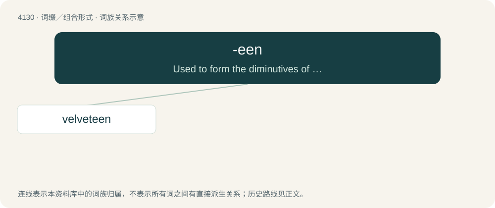

# 4141 · -een — Used to form the diminutives of nouns in Hiberno-English.

[总目录](../00_总目录_按常用程度.md)

**类型**：词缀／组合形式　｜　**来源语言**：见词源记录

## 核心含义与来源

- 核心含义：Used to form the diminutives of nouns in Hiberno-English.
- 英文含义：Used to form the diminutives of nouns in Hiberno-English.
- 词形：-een

**来源记录 1**（后缀／后置成分；Used to form the diminutives of nouns in Hiberno-English.）

Borrowed from Irish -ín (diminutive suffix).

## 词族图

## 单词速览（常用到不常用）

| 单词 | 音标 | 释义 |
|---|---|---|
| [velveteen](#w-1) | /ˈvɛlvətiːn/ | n. 棉绒, 平绒 |

## 逐词详解

### 1. velveteen

**词性**：名词　｜　**音标**：/ˈvɛlvətiːn/

**中文释义**：n. 棉绒, 平绒

**英文义项**：A cotton fabric with a short pile, resembling velvet.

**构词拆分**：velvet + -een

**词源与演化**：

From velvet + -een. Compare veloutine, from French.

**例句**：

> It was a boy dressed in ragged velveteen breeches, and thin discoloured shirt.
