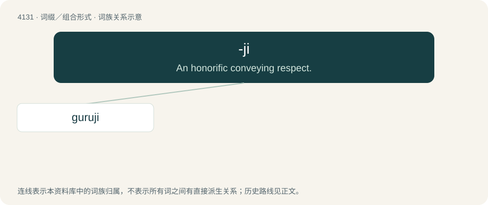

# 4142 · -ji — An honorific conveying respect.

[总目录](../00_总目录_按常用程度.md)

**类型**：词缀／组合形式　｜　**来源语言**：见词源记录

## 核心含义与来源

- 核心含义：An honorific conveying respect.
- 英文含义：An honorific conveying respect.
- 词形：-ji

**来源记录 1**（后缀／后置成分；An honorific conveying respect.）

From a suffix found in various languages of the Indian subcontinent, e.g. Hindi -जी (-jī), Punjabi -ਜੀ (-jī), etc.

## 词族图

## 单词速览（常用到不常用）

| 单词 | 音标 | 释义 |
|---|---|---|
| [guruji](#w-1) |  | 【英文】A guru or spiritual teacher. |

## 逐词详解

### 1. guruji

**词性**：名词

**英文义项**：A guru or spiritual teacher.

**构词拆分**：guru + -ji

**词源与演化**：

From guru + -ji.
