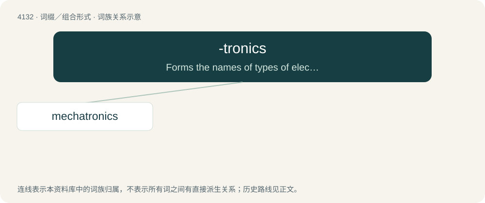

# 4143 · -tronics — Forms the names of types of electronic devices and systems. Also used to form the name of a number of electronics and technology companies.

[总目录](../00_总目录_按常用程度.md)

**类型**：词缀／组合形式　｜　**来源语言**：见词源记录

## 核心含义与来源

- 核心含义：Forms the names of types of electronic devices and systems. Also used to form the name of a number of electronics and technology companies.
- 英文含义：Forms the names of types of electronic devices and systems. Also used to form the name of a number of electronics and technology companies.
- 词形：-tronics

**来源记录 1**（后缀／后置成分；Forms the names of types of electronic devices and systems. Also used to form the name of a number of electronics and technology companies.）

Formed from a rebracketing of electronics as elec + -tronics, rather than the original electron + -ic + -s; first attested in molectronics (1959)/moletronics (1962). Equivalent to -tron + -ic + -s.

## 词族图

## 单词速览（常用到不常用）

| 单词 | 音标 | 释义 |
|---|---|---|
| [mechatronics](#w-1) |  | (mechatronic 的复数) 机电一体化 |

## 逐词详解

### 1. mechatronics

**词性**：名词

**中文释义**：(mechatronic 的复数) 机电一体化

**英文义项**：The synergistic combination of mechanical engineering, electronic engineering and software engineering for the study of automata from an engineering perspective and the control of advanced hybrid systems.

**构词拆分**：mechanics + -tronics

**词源与演化**：

From mecha(nics) + -tronics.
