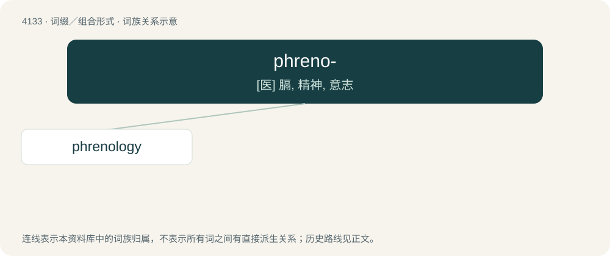

# 4144 · phreno- — \[医\] 膈, 精神, 意志

[总目录](../00_总目录_按常用程度.md)

**类型**：词缀／组合形式　｜　**来源语言**：见词源记录

## 核心含义与来源

- 核心含义：\[医\] 膈, 精神, 意志
- 英文含义：mind.
- 词形：phreno-

**来源记录 1**（前缀／前置成分；mind.）

From Ancient Greek φρήν (phrḗn).

## 词族图

## 单词速览（常用到不常用）

| 单词 | 音标 | 释义 |
|---|---|---|
| [phrenology](#w-1) | 美 /frənˈɑlədʒi/ | n. 颅相学；\[医\] 颅相学(一门唯心的学科) |

## 逐词详解

### 1. phrenology

**词性**：名词　｜　**音标**：美 /frənˈɑlədʒi/

**中文释义**：n. 颅相学；\[医\] 颅相学(一门唯心的学科)

**英文义项**：The pseudoscience which studies the relationships between a person's character and the morphology (structure) of the skull.

**构词拆分**：phreno- + -logy

**词源与演化**：

From phreno- + -logy.

**例句**：

> Phrenology involves feeling the bumps in the skull to determine an individual's psychological attributes.

该用例对应义项：The pseudoscience which studies the relationships between a person's character and the morphology (structure) of the skull.
