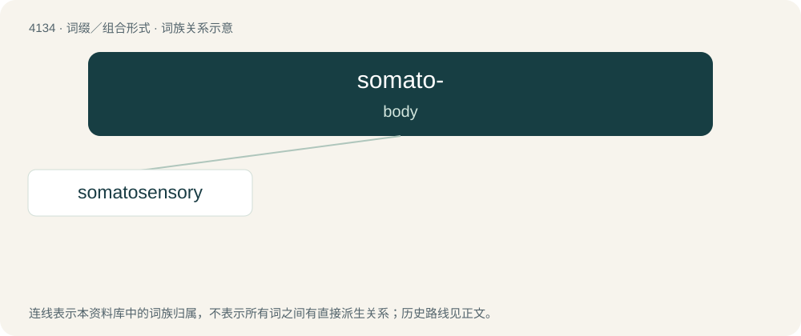

# 4145 · somato- — body

[总目录](../00_总目录_按常用程度.md)

**类型**：词缀／组合形式　｜　**来源语言**：见词源记录

## 核心含义与来源

- 核心含义：body
- 英文含义：body
- 词形：somato-

**来源记录 1**（前缀／前置成分；body）

From Ancient Greek σῶμα (sôma, “body”). Compare soma.

## 词族图

## 单词速览（常用到不常用）

| 单词 | 音标 | 释义 |
|---|---|---|
| [somatosensory](#w-1) | /,səumətəˈsensəri/ | a. (耳、目、口等以外的)体觉的 |

## 逐词详解

### 1. somatosensory

**词性**：形容词　｜　**音标**：/,səumətəˈsensəri/

**中文释义**：a. (耳、目、口等以外的)体觉的

**英文义项**：Of or pertaining to the perception of sensory stimuli produced by the skin or internal organs

**构词拆分**：somato- + sensory

**词源与演化**：

From somato- + sensory.

**例句**：

> Sensory information has to travel through the thalamus before arriving at the somatosensory cortex.
