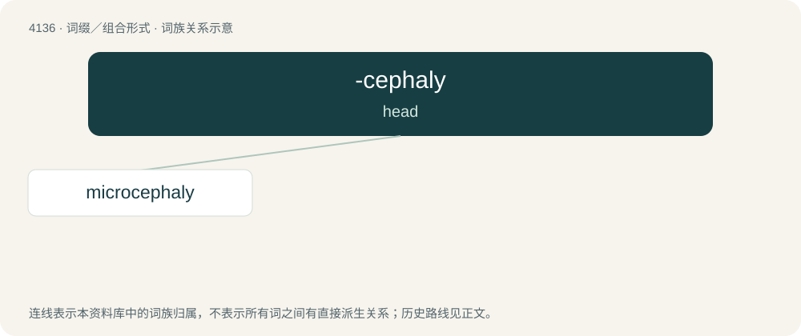

# 4146 · -cephaly — head

[总目录](../00_总目录_按常用程度.md)

**类型**：词缀／组合形式　｜　**来源语言**：见词源记录

## 核心含义与来源

- 核心含义：head
- 英文含义：head
- 词形：-cephaly

**来源记录 1**（后缀／后置成分；head）

From French -céphalie, German -zephalie, or Latin -cephalia, from Ancient Greek κεφαλή (kephalḗ, “head”) and a suffix: French -ie, German -ie, or Latin -ia.

## 词族图

## 单词速览（常用到不常用）

| 单词 | 音标 | 释义 |
|---|---|---|
| [microcephaly](#w-1) | 美 /ˌmaɪkɹoʊˈsɛfəli/ | n. 小头畸型；\[医\] 小头 |

## 逐词详解

### 1. microcephaly

**词性**：名词　｜　**音标**：美 /ˌmaɪkɹoʊˈsɛfəli/

**中文释义**：n. 小头畸型；\[医\] 小头

**英文义项**：A neurological disorder in which the person affected has an abnormally small head due to a failure of brain growth.

**构词拆分**：micro- + -cephaly

**词源与演化**：

From micro- + -cephaly.
