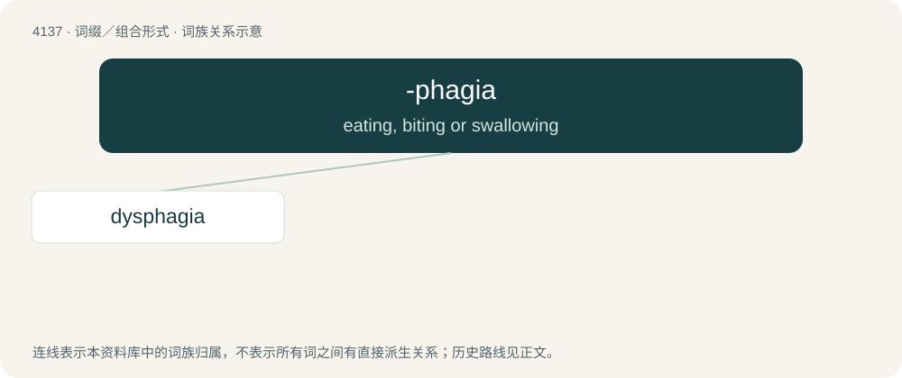

# 4147 · -phagia — eating, biting or swallowing

[总目录](../00_总目录_按常用程度.md)

**类型**：词缀／组合形式　｜　**来源语言**：见词源记录

## 核心含义与来源

- 核心含义：eating, biting or swallowing
- 英文含义：eating, biting or swallowing
- 词形：-phagia

**来源记录 1**（后缀／后置成分；eating, biting or swallowing）

From Ancient Greek -φαγία (-phagía) (compare -φάγος (-phágos, “eater”)), suffix corresponding to φαγεῖν (phageîn, “to eat”), infinitive of ἔφαγον (éphagon, “I eat”), which serves as aorist for the defective verb ἐσθίω (esthíō, “I eat”).

## 词族图

## 单词速览（常用到不常用）

| 单词 | 音标 | 释义 |
|---|---|---|
| [dysphagia](#w-1) | /dɪsˈfeɪ̯d͡ʒ(i)ə/ | n. 咽下困难, 吞咽困难；\[医\] 咽下困难 |

## 逐词详解

### 1. dysphagia

**词性**：名词　｜　**音标**：/dɪsˈfeɪ̯d͡ʒ(i)ə/

**中文释义**：n. 咽下困难, 吞咽困难；\[医\] 咽下困难

**英文义项**：Difficulty in swallowing.

**构词拆分**：dys- + -phagia

**词源与演化**：

From dys- + -phagia.
