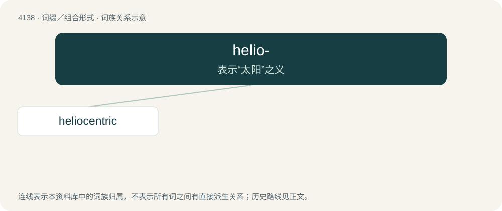

# 4148 · helio- — 表示“太阳”之义

[总目录](../00_总目录_按常用程度.md)

**类型**：词缀／组合形式　｜　**来源语言**：见词源记录

## 核心含义与来源

- 核心含义：表示“太阳”之义
- 英文含义：Concerning the sun.
- 词形：helio-

## 词族图

## 单词速览（常用到不常用）

| 单词 | 音标 | 释义 |
|---|---|---|
| [heliocentric](#w-1) | 英 /ˌhiːli.əʊˈsɛntɹɪk/；美 /ˌhiːlioʊˈsɛntɹɪk/ | a. 以太阳为中心的 |

## 逐词详解

### 1. heliocentric

**词性**：形容词　｜　**音标**：英 /ˌhiːli.əʊˈsɛntɹɪk/；美 /ˌhiːlioʊˈsɛntɹɪk/

**中文释义**：a. 以太阳为中心的

**英文义项**：Having the sun at the center/centre; usually in reference to a coordinate system or orbit. / Of or relating to heliocentrism.

**构词拆分**：helio- + -centric

**词源与演化**：

From helio- + -centric.

**用法示例／搭配（非完整句）**：

> a heliocentric coordinate system

该用例对应义项：Having the sun at the center/centre; usually in reference to a coordinate system or orbit.
