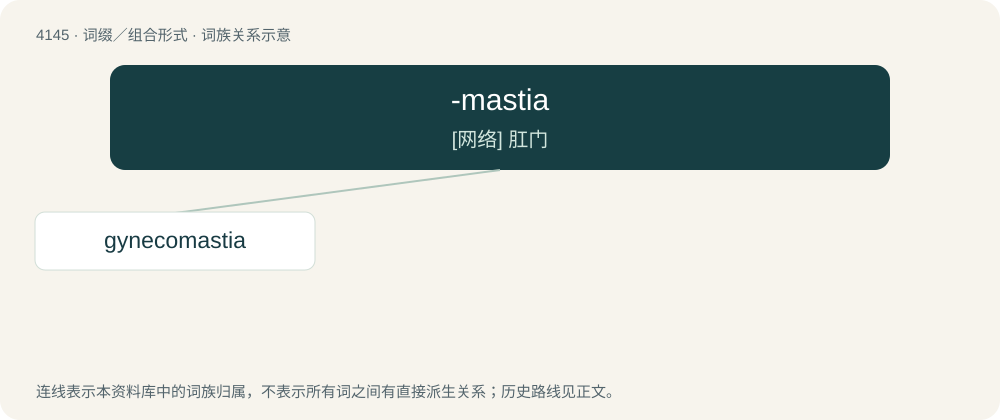

# 4156 · -mastia — \[网络\] 肛门

[总目录](../00_总目录_按常用程度.md)

**类型**：词缀／组合形式　｜　**来源语言**：见词源记录

## 核心含义与来源

- 核心含义：\[网络\] 肛门
- 英文含义：An abnormality of the breast.
- 词形：-mastia

**来源记录 1**（后缀／后置成分；An abnormality of the breast.）

From Ancient Greek μαστός (mastós, “breast”).

## 词族图

## 单词速览（常用到不常用）

| 单词 | 音标 | 释义 |
|---|---|---|
| [gynecomastia](#w-1) | 英 /ˌɡaɪ.nɪ.kəʊˈmæs.tɪə/；美 /ˌɡaɪ.nɪ.koʊˈmæs.tiə/ | a. &lt;美&gt;= gynaecomastia |

## 逐词详解

### 1. gynecomastia

**词性**：名词　｜　**音标**：英 /ˌɡaɪ.nɪ.kəʊˈmæs.tɪə/；美 /ˌɡaɪ.nɪ.koʊˈmæs.tiə/

**中文释义**：a. &lt;美&gt;= gynaecomastia

**英文义项**：Excessive development of breasts in men, resembling the breast development in women.

**构词拆分**：gyneco- + -mastia

**词源与演化**：

Internationalism. From gyneco- + -mastia.
