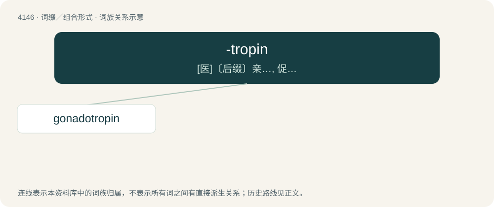

# 4157 · -tropin — \[医\]〔后缀〕亲…, 促…

[总目录](../00_总目录_按常用程度.md)

**类型**：词缀／组合形式　｜　**来源语言**：见词源记录

## 核心含义与来源

- 核心含义：\[医\]〔后缀〕亲…, 促…
- 英文含义：Hormone.
- 词形：-tropin

**来源记录 1**（后缀／后置成分；Hormone.）

From -tropic (“attracted to or acting upon”) + -in.

## 词族图

## 单词速览（常用到不常用）

| 单词 | 音标 | 释义 |
|---|---|---|
| [gonadotropin](#w-1) | /,^ɔnədəˈtrɔpin,^əjˈnædə-/ | \[化\] 促性腺素; 促性腺激素；\[医\] 促性腺激素 |

## 逐词详解

### 1. gonadotropin

**词性**：名词　｜　**音标**：/,^ɔnədəˈtrɔpin,^əjˈnædə-/

**中文释义**：\[化\] 促性腺素; 促性腺激素；\[医\] 促性腺激素

**英文义项**：Any of a group of protein hormones secreted by gonadotrope cells of the pituitary gland of vertebrates.

**构词拆分**：gonadotrope + -in + gonado- + -tropin

**词源与演化**：

From gonadotrope + -in, or from gonado- + -tropin.
