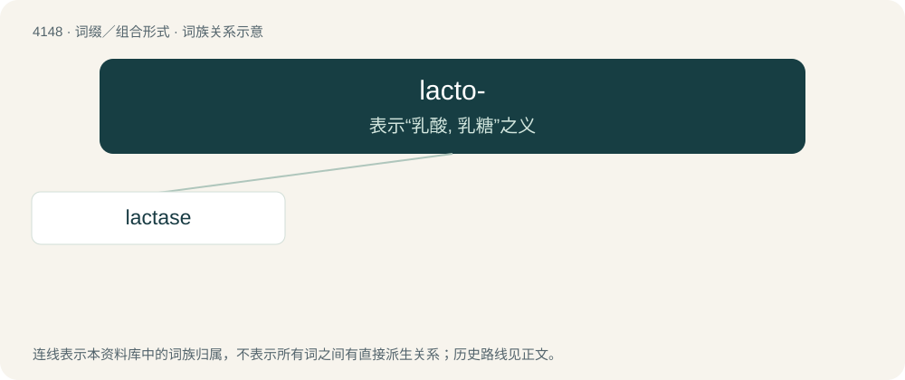

# 4159 · lacto- — 表示“乳酸, 乳糖”之义

[总目录](../00_总目录_按常用程度.md)

**类型**：词缀／组合形式　｜　**来源语言**：见词源记录

## 核心含义与来源

- 核心含义：表示“乳酸, 乳糖”之义
- 英文含义：milk.
- 词形：lacto-

**来源记录 1**（前缀／前置成分；milk.）

Derived from Latin lac (“milk”).

## 词族图

## 单词速览（常用到不常用）

| 单词 | 音标 | 释义 |
|---|---|---|
| [lactase](#w-1) | /ˈlækteis/ | n. 乳糖酶；\[化\] 乳糖酶 |

## 逐词详解

### 1. lactase

**词性**：名词　｜　**音标**：/ˈlækteis/

**中文释义**：n. 乳糖酶；\[化\] 乳糖酶

**英文义项**：A β-galactosidase enzyme that is involved in the hydrolysis of the disaccharide lactose into constituent galactose and glucose monomers.

**构词拆分**：lacto- + -ase

**词源与演化**：

From lacto- + -ase.
