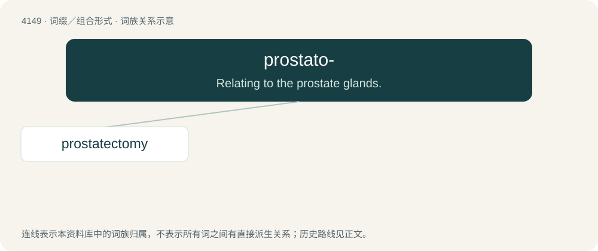

# 4160 · prostato- — Relating to the prostate glands.

[总目录](../00_总目录_按常用程度.md)

**类型**：词缀／组合形式　｜　**来源语言**：见词源记录

## 核心含义与来源

- 核心含义：Relating to the prostate glands.
- 英文含义：Relating to the prostate glands.
- 词形：prostato-

**来源记录 1**（前缀／前置成分；Relating to the prostate glands.）

From prostate, borrowed from Middle French prostate, a learned borrowing from Medieval Latin prostata, borrowed from Ancient Greek προστάτης (prostátēs), from προΐστημι (proḯstēmi) + -της (-tēs).

## 词族图

## 单词速览（常用到不常用）

| 单词 | 音标 | 释义 |
|---|---|---|
| [prostatectomy](#w-1) | /prɔstəˈtektəmi/ | \[医\] 前列腺切除术 |

## 逐词详解

### 1. prostatectomy

**词性**：名词　｜　**音标**：/prɔstəˈtektəmi/

**中文释义**：\[医\] 前列腺切除术

**英文义项**：The surgical removal of part or all of the prostate gland.

**构词拆分**：prostato- + -ectomy

**词源与演化**：

From prostato- + -ectomy.
