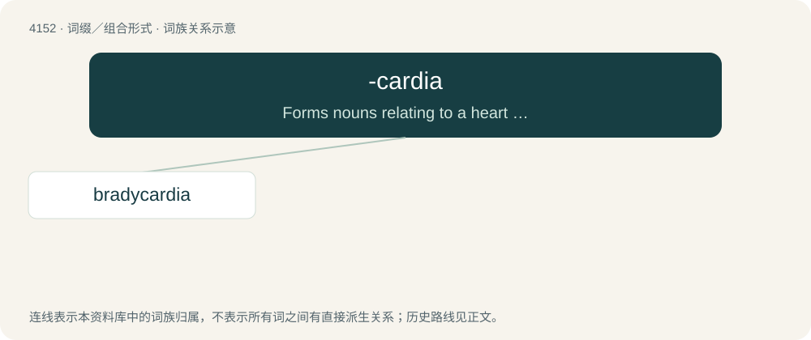

# 4163 · -cardia — Forms nouns relating to a heart condition.

[总目录](../00_总目录_按常用程度.md)

**类型**：词缀／组合形式　｜　**来源语言**：见词源记录

## 核心含义与来源

- 核心含义：Forms nouns relating to a heart condition.
- 英文含义：Forms nouns relating to a heart condition.
- 词形：-cardia

**来源记录 1**（后缀／后置成分；Forms nouns relating to a heart condition.）

Learned borrowing from Ancient Greek κᾰρδῐ́ᾱ (kărdĭ́ā, “heart”) + -ῐ́ᾱ (-ĭ́ā, suffix forming abstract nouns), equivalent to cardia + -ia.

## 词族图

## 单词速览（常用到不常用）

| 单词 | 音标 | 释义 |
|---|---|---|
| [bradycardia](#w-1) | 英 /bɹæ.dɪˈkɑː(ɹ).di.ə/；美 /bɹeɪ.dɪˈkɑɹ.di.ə/ | n. 心动过缓, 心搏徐缓；\[医\] 心搏徐缓 |

## 逐词详解

### 1. bradycardia

**词性**：名词　｜　**音标**：英 /bɹæ.dɪˈkɑː(ɹ).di.ə/；美 /bɹeɪ.dɪˈkɑɹ.di.ə/

**中文释义**：n. 心动过缓, 心搏徐缓；\[医\] 心搏徐缓

**英文义项**：The condition of having a slow heartbeat, defined as under 60 beats per minute for an adult.

**构词拆分**：brady- + -cardia

**词源与演化**：

From Ancient Greek βραδύς (bradús, “slow”) + καρδία (kardía, “heart”), equivalent to brady- + -cardia.
