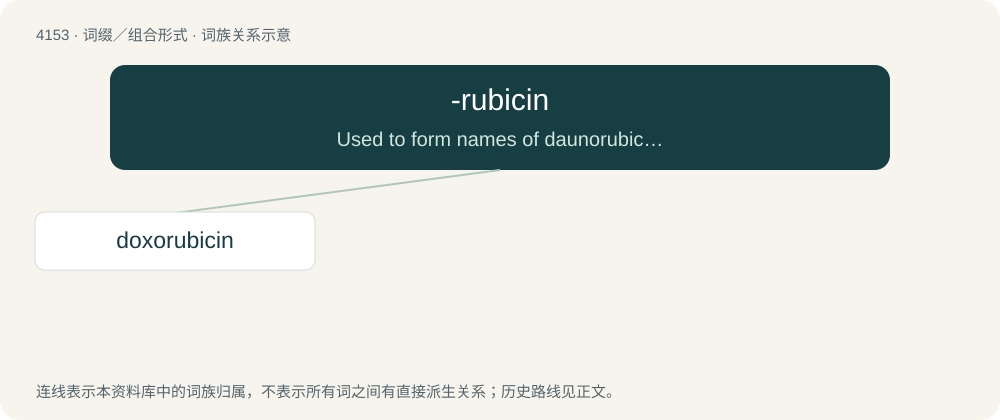

# 4164 · -rubicin — Used to form names of daunorubicin derivatives used as antineoplastics.

[总目录](../00_总目录_按常用程度.md)

**类型**：词缀／组合形式　｜　**来源语言**：见词源记录

## 核心含义与来源

- 核心含义：Used to form names of daunorubicin derivatives used as antineoplastics.
- 英文含义：Used to form names of daunorubicin derivatives used as antineoplastics.
- 词形：-rubicin

**来源记录 1**（后缀／后置成分；Used to form names of daunorubicin derivatives used as antineoplastics.）

From daunorubicin.

## 词族图

## 单词速览（常用到不常用）

| 单词 | 音标 | 释义 |
|---|---|---|
| [doxorubicin](#w-1) | 英 /ˌdɒk.səʊˈɹuː.bɪs.ɪn/；美 /ˌdɑk.səˈɹu.bɪs.ɪn/ | \[化\] 阿霉素 |

## 逐词详解

### 1. doxorubicin

**词性**：名词　｜　**音标**：英 /ˌdɒk.səʊˈɹuː.bɪs.ɪn/；美 /ˌdɑk.səˈɹu.bɪs.ɪn/

**中文释义**：\[化\] 阿霉素

**英文义项**：An anthracycline antibiotic drug (trademark Adriamycin) with broad antineoplastic activity that is obtained from a bacterium (Streptomyces peucetius subsp. caesius) and is administered in the form of its hydrochloride C₂₇H₂₉NO₁₁·HCl in chemotherapy.

**构词拆分**：deoxy- + -o- + -rubicin

**词源与演化**：

From d(e)ox(y)- + -o- + -rubicin (“daunorubicin derivative”).
