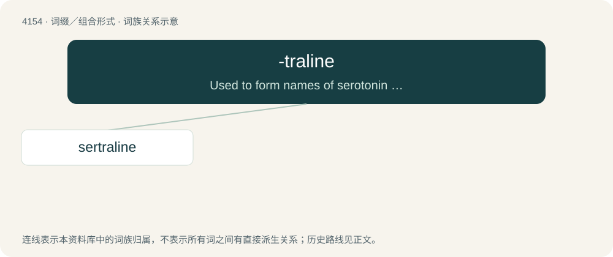

# 4165 · -traline — Used to form names of serotonin reuptake inhibitors.

[总目录](../00_总目录_按常用程度.md)

**类型**：词缀／组合形式　｜　**来源语言**：见词源记录

## 核心含义与来源

- 核心含义：Used to form names of serotonin reuptake inhibitors.
- 英文含义：Used to form names of serotonin reuptake inhibitors.
- 词形：-traline

**来源记录 1**（后缀／后置成分；Used to form names of serotonin reuptake inhibitors.）

From tetralin.

## 词族图

## 单词速览（常用到不常用）

| 单词 | 音标 | 释义 |
|---|---|---|
| [sertraline](#w-1) | 英 /ˈsɜː.tɹəˌliːn/；美 /ˈsɜɹ.tɹəˌlin/ | 舍曲林 |

## 逐词详解

### 1. sertraline

**词性**：名词　｜　**音标**：英 /ˈsɜː.tɹəˌliːn/；美 /ˈsɜɹ.tɹəˌlin/

**中文释义**：舍曲林

**英文义项**：An antidepressant drug C₁₇H₁₇NCl₂ administered in the form of its hydrochloride and acting to enhance serotonin activity.

**构词拆分**：ser(otonin) + -traline (“serotonin reuptake inhibitor”)

**词源与演化**：

From ser(otonin) + -traline (“serotonin reuptake inhibitor”).
