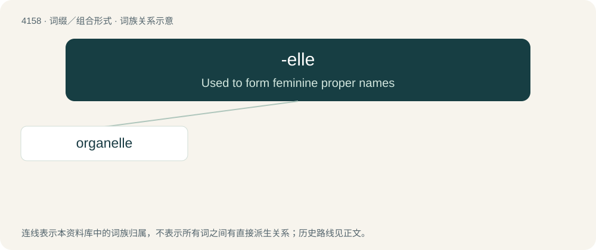

# 4169 · -elle — Used to form feminine proper names

[总目录](../00_总目录_按常用程度.md)

**类型**：词缀／组合形式　｜　**来源语言**：见词源记录

## 核心含义与来源

- 核心含义：Used to form feminine proper names
- 英文含义：Used to form feminine proper names
- 词形：-elle

**来源记录 1**（后缀／后置成分；Used to form feminine proper names）

From French -elle.

## 词族图

## 单词速览（常用到不常用）

| 单词 | 音标 | 释义 |
|---|---|---|
| [organelle](#w-1) | 美 /ˌɔɹ.ɡənˈɛl/ | n. 细胞器；\[医\] 细胞器, 小器官 |

## 逐词详解

### 1. organelle

**词性**：名词　｜　**音标**：美 /ˌɔɹ.ɡənˈɛl/

**中文释义**：n. 细胞器；\[医\] 细胞器, 小器官

**英文义项**：A specialized structure found inside cells that carries out a specific life process (e.g. ribosomes, vacuoles).

**构词拆分**：organ + -elle

**词源与演化**：

From organ + -elle.

**例句**：

> The first organelle to be identified was the nucleus.

该用例对应义项：a specialized part of a cell; analogous to an organ
