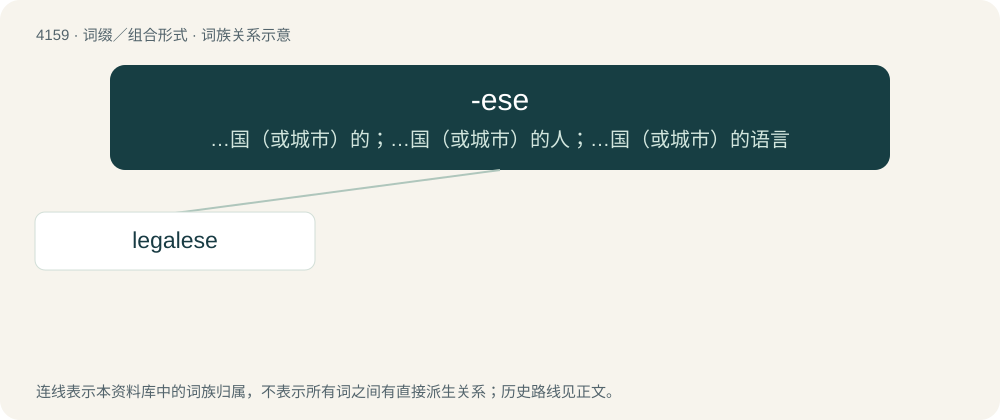

# 4170 · -ese — …国（或城市）的；…国（或城市）的人；…国（或城市）的语言

[总目录](../00_总目录_按常用程度.md)

**类型**：词缀／组合形式　｜　**来源语言**：见词源记录

## 核心含义与来源

- 核心含义：…国（或城市）的；…国（或城市）的人；…国（或城市）的语言
- 英文含义：Used to form adjectives and nouns describing things and characteristics of a city, region, or country, such as the people and the language spoken by these people.
- 词形：-ese

**来源记录 1**（后缀／后置成分；Used to form adjectives and nouns describing things and characteristics of a city, region, or country, such as the people and the language spoken by these people.）

From Middle English -eys, from Old French -eis, from Latin -ēnsis and, less often, Late Latin -iscus. Generally used in place of more common equivalent suffixes such as -er and -an on the model of equivalent terms in Italian and Portuguese, particularly for Italian, Portuguese African, and East Asian places first widely discussed in Portuguese and Latin.

## 词族图

## 单词速览（常用到不常用）

| 单词 | 音标 | 释义 |
|---|---|---|
| [legalese](#w-1) | 英 /ˌliː.ɡəˈliːz/；美 /ˌli.ɡəˈliz/ | n. 法律措辞, 法律术语 |

## 逐词详解

### 1. legalese

**词性**：名词　｜　**音标**：英 /ˌliː.ɡəˈliːz/；美 /ˌli.ɡəˈliz/

**中文释义**：n. 法律措辞, 法律术语

**英文义项**：Technical jargon common in the legal profession; the argot of lawyers. / Wordy, ostentatious talk or writing that resembles legal writing, especially when confusing to laypeople; bureaucratese; officialese.

**构词拆分**：legal + -ese

**词源与演化**：

From legal + -ese.

**例句**：

> I can't understand any of this legalese.
