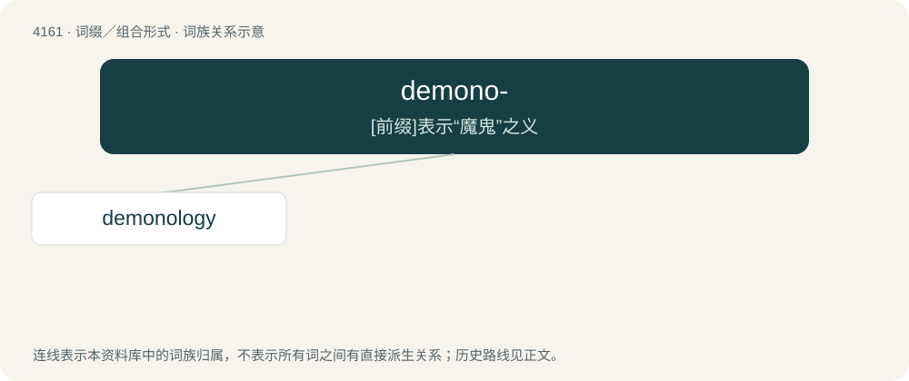

# 4172 · demono- — \[前缀\]表示“魔鬼”之义

[总目录](../00_总目录_按常用程度.md)

**类型**：词缀／组合形式　｜　**来源语言**：见词源记录

## 核心含义与来源

- 核心含义：\[前缀\]表示“魔鬼”之义
- 英文含义：Demon.
- 词形：demono-

**来源记录 1**（前缀／前置成分；Demon.）

From Latin.

## 词族图

## 单词速览（常用到不常用）

| 单词 | 音标 | 释义 |
|---|---|---|
| [demonology](#w-1) | 英 /ˌdiːməˈnɒlədʒi/；美 /ˌdiːməˈnɑːləd͡ʒi/ | \[医\] 魔凭论 |

## 逐词详解

### 1. demonology

**词性**：名词　｜　**音标**：英 /ˌdiːməˈnɒlədʒi/；美 /ˌdiːməˈnɑːləd͡ʒi/

**中文释义**：\[医\] 魔凭论

**英文义项**：The study of demons, especially the incantations required to summon and control them.

**构词拆分**：demono- + -logy

**词源与演化**：

From demono- + -logy.
