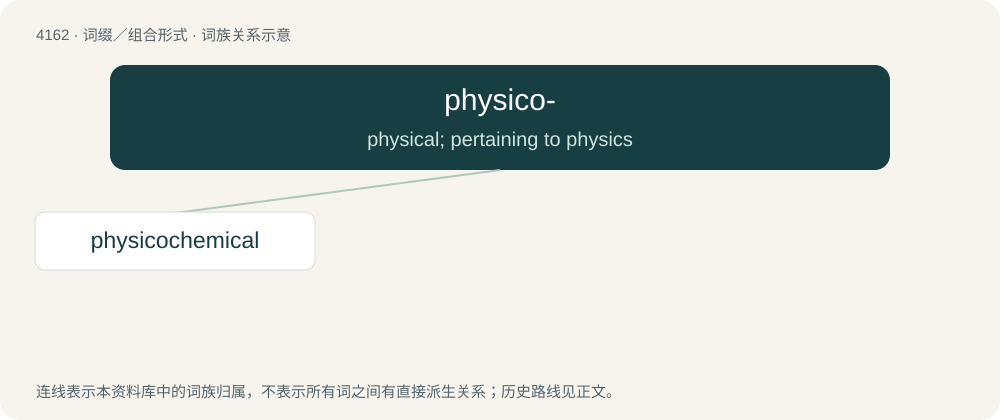

# 4173 · physico- — physical; pertaining to physics

[总目录](../00_总目录_按常用程度.md)

**类型**：词缀／组合形式　｜　**来源语言**：见词源记录

## 核心含义与来源

- 核心含义：physical; pertaining to physics
- 英文含义：physical; pertaining to physics
- 词形：physico-

**来源记录 1**（前缀／前置成分；physical; pertaining to physics）

From Ancient Greek; see physical.

## 词族图

## 单词速览（常用到不常用）

| 单词 | 音标 | 释义 |
|---|---|---|
| [physicochemical](#w-1) | /,fizikəuˈkemikəl/ | a. 物理化学的；\[医\] 物理化学的 |

## 逐词详解

### 1. physicochemical

**词性**：形容词　｜　**音标**：/,fizikəuˈkemikəl/

**中文释义**：a. 物理化学的；\[医\] 物理化学的

**英文义项**：Dependent on the joint action of both physical and chemical processes. / Of or pertaining to physical chemistry.

**构词拆分**：physico- + chemical

**词源与演化**：

From physico- + chemical.
