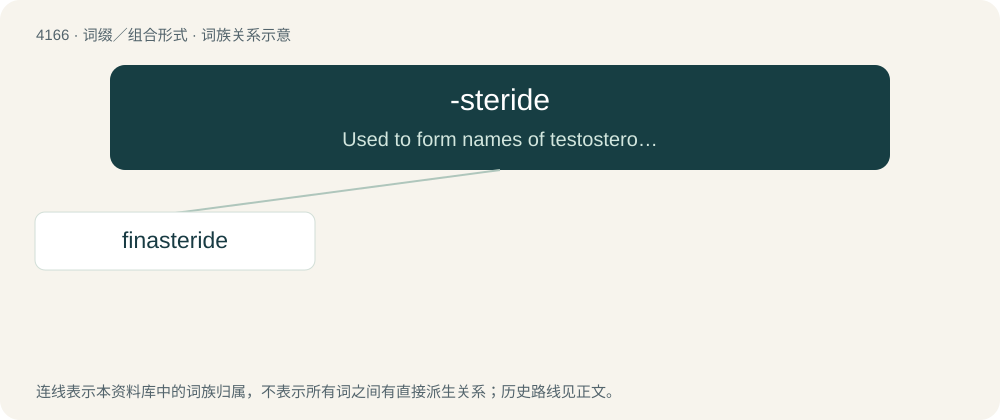

# 4175 · -steride — Used to form names of testosterone reductase inhibitors.

[总目录](../00_总目录_按常用程度.md)

**类型**：词缀／组合形式　｜　**来源语言**：见词源记录

## 核心含义与来源

- 核心含义：Used to form names of testosterone reductase inhibitors.
- 英文含义：Used to form names of testosterone reductase inhibitors.
- 词形：-steride

## 词族图

## 单词速览（常用到不常用）

| 单词 | 音标 | 释义 |
|---|---|---|
| [finasteride](#w-1) | /fɪnˈæs.təɹ.aɪd/ | \[医\]非那司提（治疗良性前列腺增生） |

## 逐词详解

### 1. finasteride

**词性**：名词　｜　**音标**：/fɪnˈæs.təɹ.aɪd/

**中文释义**：\[医\]非那司提（治疗良性前列腺增生）

**英文义项**：A medication used to treat male pattern baldness and benign prostatic hyperplasia in males.

**构词拆分**：fina (“possibly a coined pharmaceutical name developed by scientists at Merck”) + -steride (“a testosterone reductase inhibitor”)

**词源与演化**：

From fina (“possibly a coined pharmaceutical name developed by scientists at Merck”) + -steride (“a testosterone reductase inhibitor”). First use appears c. 1989 in the publication Pharmaceutical Business News.
