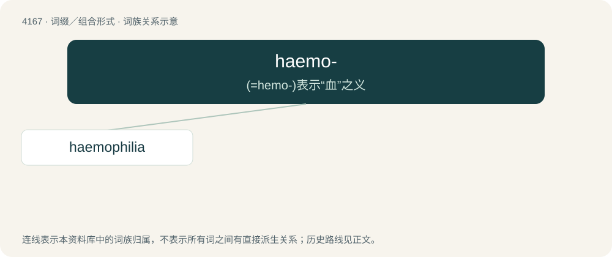

# 4177 · haemo- — (=hemo-)表示“血”之义

[总目录](../00_总目录_按常用程度.md)

**类型**：词缀／组合形式　｜　**来源语言**：见词源记录

## 核心含义与来源

- 核心含义：(=hemo-)表示“血”之义
- 英文含义：Pertaining to blood.
- 词形：haemo-

**来源记录 1**（前缀／前置成分；Pertaining to blood.）

From Ancient Greek αἱμο- (haimo-), from αἷμα (haîma, “blood”).

## 词族图

## 单词速览（常用到不常用）

| 单词 | 音标 | 释义 |
|---|---|---|
| [haemophilia](#w-1) | /ˌhiːməˈfɪliə | n. \[医\]血友病, 出血不止症 |

## 逐词详解

### 1. haemophilia

**词性**：名词　｜　**音标**：/ˌhiːməˈfɪliə

**中文释义**：n. \[医\]血友病, 出血不止症

**英文义项**：Any of several hereditary illnesses that impair the body's ability to control bleeding, usually passed from mother to son.

**构词拆分**：haemo- + -philia

**词源与演化**：

From haemo- + -philia, from Ancient Greek αἷμα (haîma, “blood”) + φιλία (philía, “friendship”). Originally called haemorrhaphilia, probably from the word haemorrhage.

**例句**：

> All the jobs I aspired to were denied to me due to my haemophilia.
