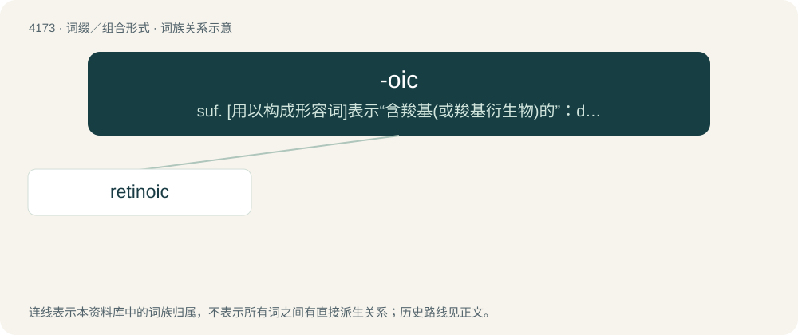

# 4180 · -oic — suf. \[用以构成形容词\]表示“含羧基(或羧基衍生物)的”：decanoic

[总目录](../00_总目录_按常用程度.md)

**类型**：词缀／组合形式　｜　**来源语言**：见词源记录

## 核心含义与来源

- 核心含义：suf. \[用以构成形容词\]表示“含羧基(或羧基衍生物)的”：decanoic
- 英文含义：used to form the names of carboxylic groups and acids
- 词形：-oic

**来源记录 1**（后缀／后置成分；used to form the names of carboxylic groups and acids）

Clipped from benzoic.

## 词族图

## 单词速览（常用到不常用）

| 单词 | 音标 | 释义 |
|---|---|---|
| [retinoic](#w-1) |  | \[医\]Tretinoin |

## 逐词详解

### 1. retinoic

**词性**：形容词

**中文释义**：\[医\]Tretinoin

**英文义项**：Derived from retinol; relating to retinoic acid or its derivatives

**构词拆分**：From retina + -oic.

**词源与演化**：

From retina + -oic.

**例句**：

> Tom's liver quickly turned the sardines into retinoic acid.
