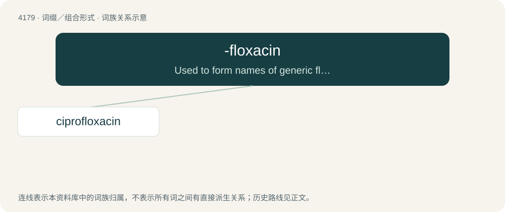

# 4186 · -floxacin — Used to form names of generic fluoroquinolone antibiotics

[总目录](../00_总目录_按常用程度.md)

**类型**：词缀／组合形式　｜　**来源语言**：见词源记录

## 核心含义与来源

- 核心含义：Used to form names of generic fluoroquinolone antibiotics
- 英文含义：Used to form names of generic fluoroquinolone antibiotics
- 词形：-floxacin

**来源记录 1**（后缀／后置成分；Used to form names of generic fluoroquinolone antibiotics）

From norfloxacin.

## 词族图

## 单词速览（常用到不常用）

| 单词 | 音标 | 释义 |
|---|---|---|
| [ciprofloxacin](#w-1) | 美 /ˌsɪp.ɹəˈflɑk.səs.ɪn/ | \[医\]环丙沙星：合成抗菌药, 对革兰氏阳性和阴性包括一些对青霉素类、头孢菌素灰和氨基糖苷类抗药的菌株, 亦可收效 |

## 逐词详解

### 1. ciprofloxacin

**词性**：名词　｜　**音标**：美 /ˌsɪp.ɹəˈflɑk.səs.ɪn/

**中文释义**：\[医\]环丙沙星：合成抗菌药, 对革兰氏阳性和阴性包括一些对青霉素类、头孢菌素灰和氨基糖苷类抗药的菌株, 亦可收效

**英文义项**：A broad-spectrum fluoroquinolone antibiotic C₁₇H₁₈FN₃O₃ that is often administered in the form of its hydrochloride C₁₇H₁₈FN₃O₃·HCl and is effective especially against gram-negative bacteria.

**构词拆分**：cyclopropyl + -floxacin

**词源与演化**：

From cy(clo)pro(pyl) + -floxacin (“nalidixic acid derivative”).

**例句**：

> The doctor prescribed me Ciprofloxacin for my urinary tract infection.
