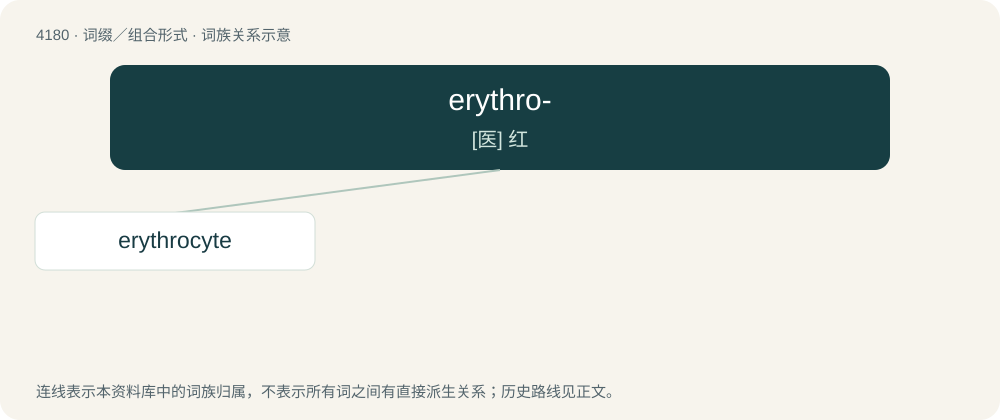

# 4187 · erythro- — \[医\] 红

[总目录](../00_总目录_按常用程度.md)

**类型**：词缀／组合形式　｜　**来源语言**：见词源记录

## 核心含义与来源

- 核心含义：\[医\] 红
- 英文含义：Used to form scientific terms meaning red, or showing a relationship to red blood cells.
- 词形：erythro-

**来源记录 1**（前缀／前置成分；Used to form scientific terms meaning red, or showing a relationship to red blood cells.）

Derived from Ancient Greek ἐρῠθρός (erŭthrós, “red”).

## 词族图

## 单词速览（常用到不常用）

| 单词 | 音标 | 释义 |
|---|---|---|
| [erythrocyte](#w-1) | /əˈɹɪθɹəˌsaɪt/ | n. 红血球；\[医\] 红细胞 |

## 逐词详解

### 1. erythrocyte

**词性**：名词　｜　**音标**：/əˈɹɪθɹəˌsaɪt/

**中文释义**：n. 红血球；\[医\] 红细胞

**英文义项**：A hemoglobin-containing cell, especially as found in humans but more generally present in the blood of most vertebrates, that is involved with the transport of oxygen; such cells are usually anucleate in humans and many other animals.

**构词拆分**：erythro- (“red”) + -cyte (“cell”)

**词源与演化**：

From erythro- (“red”) + -cyte (“cell”), referring to the red color of hemoglobin when oxygen is bound to it.
