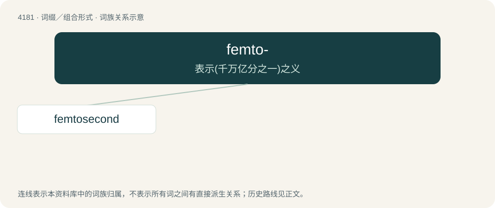

# 4188 · femto- — 表示(千万亿分之一)之义

[总目录](../00_总目录_按常用程度.md)

**类型**：词缀／组合形式　｜　**来源语言**：见词源记录

## 核心含义与来源

- 核心含义：表示(千万亿分之一)之义
- 英文含义：In the International System of Units and other metric systems of units, multiplying the unit to which it is attached by 10⁻¹⁵ (short scale quadrillionth or long scale billiardth).
- 词形：femto-

**来源记录 1**（前缀／前置成分；In the International System of Units and other metric systems of units, multiplying the unit to which it is attached by 10⁻¹⁵ (short scale quadrillionth or long scale billiardth).）

From Danish femten (“fifteen”), with reference to the (negative) exponent in the relevant power of ten; the same principle also explains atto-.

## 词族图

## 单词速览（常用到不常用）

| 单词 | 音标 | 释义 |
|---|---|---|
| [femtosecond](#w-1) | /femˈtəʊsiːkənd/ | n. 毫微微秒 |

## 逐词详解

### 1. femtosecond

**词性**：名词　｜　**音标**：/femˈtəʊsiːkənd/

**中文释义**：n. 毫微微秒

**英文义项**：An SI unit of time equal to 10⁻¹⁵ seconds. Symbol: fs

**构词拆分**：femto- + second

**词源与演化**：

From femto- + second.
