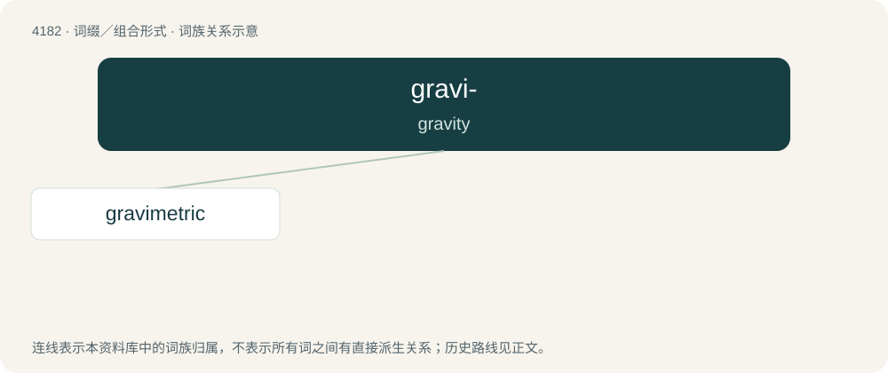

# 4189 · gravi- — gravity

[总目录](../00_总目录_按常用程度.md)

**类型**：词缀／组合形式　｜　**来源语言**：见词源记录

## 核心含义与来源

- 核心含义：gravity
- 英文含义：gravity
- 词形：gravi-

**来源记录 1**（前缀／前置成分；gravity）

From Latin gravitās, from gravis.

## 词族图

## 单词速览（常用到不常用）

| 单词 | 音标 | 释义 |
|---|---|---|
| [gravimetric](#w-1) | /,^ræviˈmetrik/ | a. 测定重量的, 重量分析的 |

## 逐词详解

### 1. gravimetric

**词性**：形容词　｜　**音标**：/,^ræviˈmetrik/

**中文释义**：a. 测定重量的, 重量分析的

**英文义项**：Of or pertaining to measurement by weight. / Of or pertaining to measurement of the local gravitational field.

**构词拆分**：gravi- + -metric

**词源与演化**：

From gravi- + -metric.
