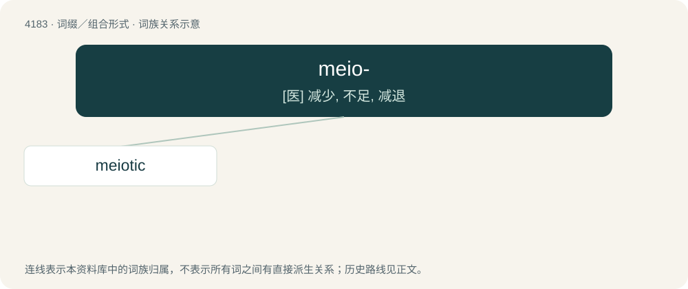

# 4190 · meio- — \[医\] 减少, 不足, 减退

[总目录](../00_总目录_按常用程度.md)

**类型**：词缀／组合形式　｜　**来源语言**：见词源记录

## 核心含义与来源

- 核心含义：\[医\] 减少, 不足, 减退
- 英文含义：Small, little.
- 词形：meio-

**来源记录 1**（前缀／前置成分；Small, little.）

Ultimately from Ancient Greek μεῖον (meîon, “less”).

## 词族图

## 单词速览（常用到不常用）

| 单词 | 音标 | 释义 |
|---|---|---|
| [meiotic](#w-1) | /maiˈɔtik/ | 减数分裂的 |

## 逐词详解

### 1. meiotic

**词性**：形容词　｜　**音标**：/maiˈɔtik/

**中文释义**：减数分裂的

**英文义项**：Of or pertaining to meiosis.

**构词拆分**：meio- + -tic

**词源与演化**：

Coined by British biologists John Bretland Farmer and John Edmund Sharrock Moore in 1905 as maiotic in a paper in the Quarterly Journal of Microscopic Science, with the spelling corrected on etymological grounds later that year. Equivalent to meio- + -tic.
