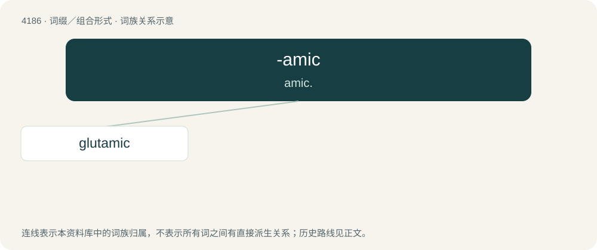

# 4194 · -amic — amic.

[总目录](../00_总目录_按常用程度.md)

**类型**：词缀／组合形式　｜　**来源语言**：见词源记录

## 核心含义与来源

- 核心含义：amic.
- 英文含义：amic.
- 词形：-amic

**来源记录 1**（后缀／后置成分；amic.）

From am(monia) + -ic.

## 词族图

## 单词速览（常用到不常用）

| 单词 | 音标 | 释义 |
|---|---|---|
| [glutamic](#w-1) | /ɡluːˈtæmɪk/ | a. 谷氨酸的 |

## 逐词详解

### 1. glutamic

**词性**：形容词　｜　**音标**：/ɡluːˈtæmɪk/

**中文释义**：a. 谷氨酸的

**英文义项**：Of, pertaining to, or derived from glutamic acid

**词源与演化**：

Latin gluten (“glue”) + -amic
