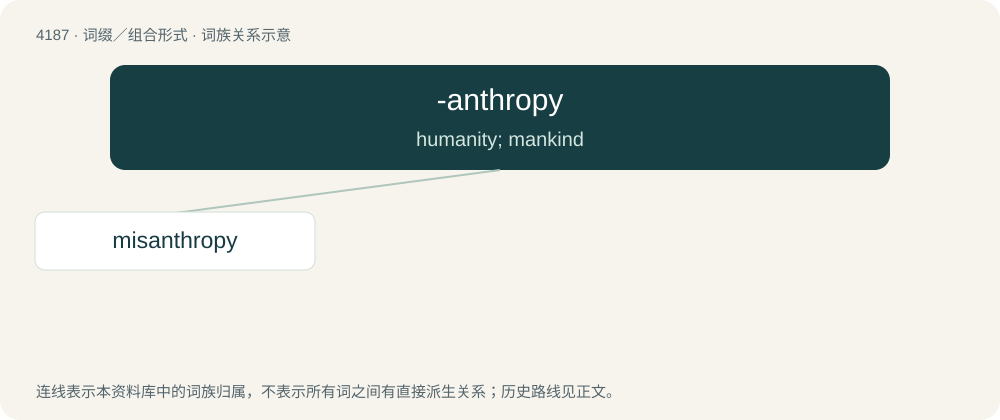

# 4195 · -anthropy — humanity; mankind

[总目录](../00_总目录_按常用程度.md)

**类型**：词缀／组合形式　｜　**来源语言**：见词源记录

## 核心含义与来源

- 核心含义：humanity; mankind
- 英文含义：humanity; mankind
- 词形：-anthropy

**来源记录 1**（后缀／后置成分；humanity; mankind）

From Ancient Greek ἄνθρωπος (ánthrōpos, “human”).

## 词族图

## 单词速览（常用到不常用）

| 单词 | 音标 | 释义 |
|---|---|---|
| [misanthropy](#w-1) | /mɪˈsæn.θɹə.pi/ | n. 厌恶人类, 不愿与人来往 |

## 逐词详解

### 1. misanthropy

**词性**：名词　｜　**音标**：/mɪˈsæn.θɹə.pi/

**中文释义**：n. 厌恶人类, 不愿与人来往

**英文义项**：A negative view or hatred of the human race.

**构词拆分**：miso- + -anthropy

**词源与演化**：

From Ancient Greek μισανθρωπία (misanthrōpía), from μισάνθρωπος (misánthrōpos), from μῖσος (mîsos, “hatred”) + ἄνθρωπος (ánthrōpos, “human”). The word is analysable as miso- + -anthropy.

**例句**：

> There are many men in London, you know, who, some from shyness, some from misanthropy, have no wish for the company of their fellows.
