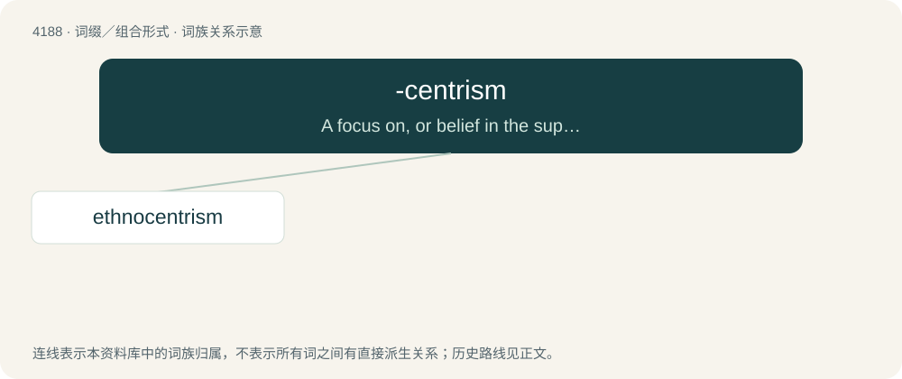

# 4196 · -centrism — A focus on, or belief in the superiority of, one culture, people, place, or other thing.

[总目录](../00_总目录_按常用程度.md)

**类型**：词缀／组合形式　｜　**来源语言**：见词源记录

## 核心含义与来源

- 核心含义：A focus on, or belief in the superiority of, one culture, people, place, or other thing.
- 英文含义：A focus on, or belief in the superiority of, one culture, people, place, or other thing.
- 词形：-centrism

**来源记录 1**（后缀／后置成分；A focus on, or belief in the superiority of, one culture, people, place, or other thing.）

Back-formation from -centric.

## 词族图

## 单词速览（常用到不常用）

| 单词 | 音标 | 释义 |
|---|---|---|
| [ethnocentrism](#w-1) | /ˌɛθ.nəʊˈsɛn.tɹɪzm̩/ | n. 民族优越感 |

## 逐词详解

### 1. ethnocentrism

**词性**：名词　｜　**音标**：/ˌɛθ.nəʊˈsɛn.tɹɪzm̩/

**中文释义**：n. 民族优越感

**英文义项**：The tendency to look at the world primarily from the perspective of one's own traditional, deferred, or adoptive ethnic culture.

**构词拆分**：ethno- + -centrism

**词源与演化**：

From ethno- + -centrism.

**例句**：

> Monolingualism is like a disease, as it leads to ethnocentrism and culture isolation. But this disease can be cured.
