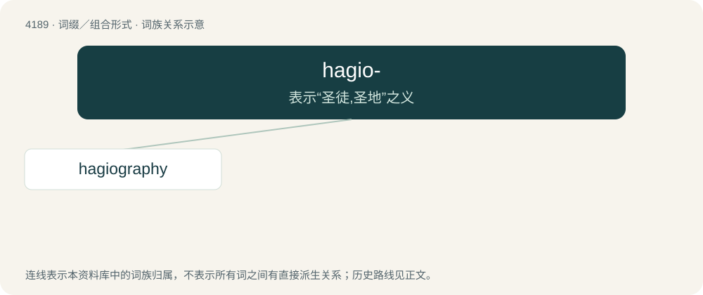

# 4197 · hagio- — 表示“圣徒,圣地”之义

[总目录](../00_总目录_按常用程度.md)

**类型**：词缀／组合形式　｜　**来源语言**：见词源记录

## 核心含义与来源

- 核心含义：表示“圣徒,圣地”之义
- 英文含义：saints
- 词形：hagio-

**来源记录 1**（前缀／前置成分；saints）

From combining form of Ancient Greek ἅγιος (hágios, “holy, saintly”).

## 词族图

## 单词速览（常用到不常用）

| 单词 | 音标 | 释义 |
|---|---|---|
| [hagiography](#w-1) | 英 /ˌhæɡiˈɒɡɹəfi/；美 /ˌhæɡiˈɒɡɹəfi/ | n. 圣徒传, 圣徒言行录 |

## 逐词详解

### 1. hagiography

**词性**：名词　｜　**音标**：英 /ˌhæɡiˈɒɡɹəfi/；美 /ˌhæɡiˈɒɡɹəfi/

**中文释义**：n. 圣徒传, 圣徒言行录

**英文义项**：The study of saints and the documentation of their lives. / A biography of a saint.

**构词拆分**：hagio- + -graphy

**词源与演化**：

From hagio- + -graphy.
