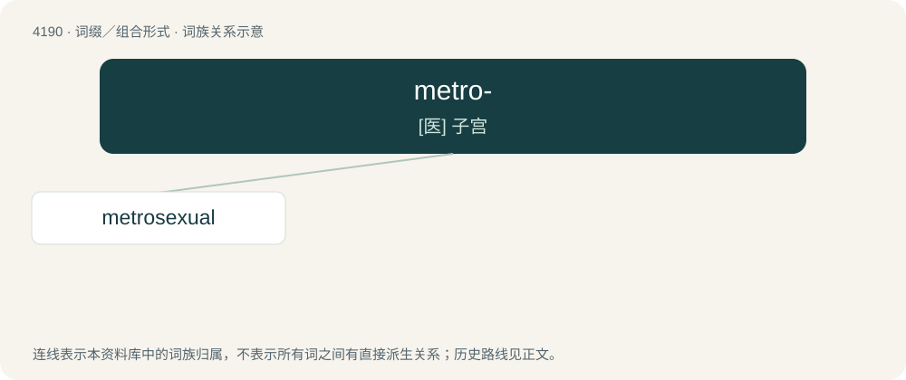

# 4198 · metro- — \[医\] 子宫

[总目录](../00_总目录_按常用程度.md)

**类型**：词缀／组合形式　｜　**来源语言**：见词源记录

## 核心含义与来源

- 核心含义：\[医\] 子宫
- 英文含义：metropolitan: of or relating to the city.
- 词形：metro-

**多个词源／构词路径**：同一拼写可能有不同来源；以下按词性和含义分别列出。

**来源记录 1**（前缀／前置成分；metropolitan: of or relating to the city.）

Clipping of metropolitan.

**来源记录 2**（前缀／前置成分；Uterus; uterine.）

From metra, medical English, via New Latin, via Ancient Greek μήτρα (mḗtra), "uterus".

## 词族图

## 单词速览（常用到不常用）

| 单词 | 音标 | 释义 |
|---|---|---|
| [metrosexual](#w-1) | /ˌmɛtɹəˈsɛkʃuəl/ | n. 都市玉男, 城市魅男, 都市美直男 |

## 逐词详解

### 1. metrosexual

**词性**：名词　｜　**音标**：/ˌmɛtɹəˈsɛkʃuəl/

**中文释义**：n. 都市玉男, 城市魅男, 都市美直男

**英文义项**：A man — typically urban, heterosexual, and affluent — who is concerned with personal appearance, such as personal grooming, fashion, and aesthetics in general. / A heterosexual man who is seen, sociologically, as having attributes common to homosexuals.

**构词拆分**：metro- + -sexual

**词源与演化**：

Blend of metropolitan + heterosexual, equivalent to metro- + -sexual. Coined by British writer Mark Simpson in 1994, it enjoyed a brief popularity in the early 2000s.
