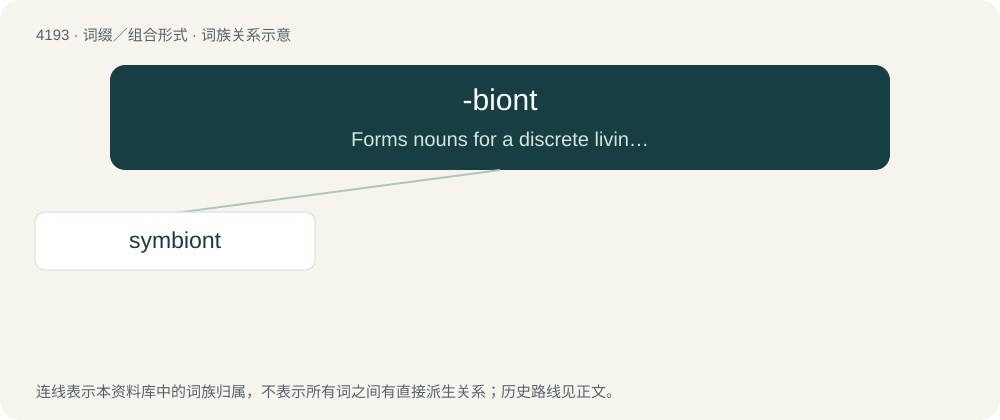

# 4202 · -biont — Forms nouns for a discrete living organism that has a specified mode of living.

[总目录](../00_总目录_按常用程度.md)

**类型**：词缀／组合形式　｜　**来源语言**：见词源记录

## 核心含义与来源

- 核心含义：Forms nouns for a discrete living organism that has a specified mode of living.
- 英文含义：Forms nouns for a discrete living organism that has a specified mode of living.
- 词形：-biont

**来源记录 1**（后缀／后置成分；Forms nouns for a discrete living organism that has a specified mode of living.）

Probably from German, modification of Ancient Greek βῐούντ- (bĭoúnt-), βιῶν (biôn, “living”), present participle of βῐοῦν (bĭoûn, “to live”), from βῐ́ος (bĭ́os, “mode of life”).

## 词族图

## 单词速览（常用到不常用）

| 单词 | 音标 | 释义 |
|---|---|---|
| [symbiont](#w-1) | 英 /sɪmˈbaɪ.ɒnt/；美 /sɪmˈbaɪ.ɑnt/ | n. 共生者；\[医\] 共生生物 |

## 逐词详解

### 1. symbiont

**词性**：名词　｜　**音标**：英 /sɪmˈbaɪ.ɒnt/；美 /sɪmˈbaɪ.ɑnt/

**中文释义**：n. 共生者；\[医\] 共生生物

**英文义项**：An organism that lives in a symbiotic relationship.

**构词拆分**：sym- + -biont

**词源与演化**：

From sym- + -biont.
