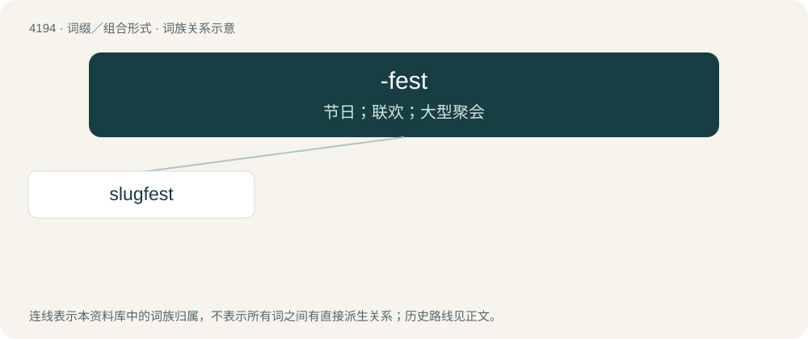

# 4203 · -fest — 节日；联欢；大型聚会

[总目录](../00_总目录_按常用程度.md)

**类型**：词缀／组合形式　｜　**来源语言**：见词源记录

## 核心含义与来源

- 核心含义：节日；联欢；大型聚会
- 英文含义：A festival, a fest; used in names of events.
- 词形：-fest

**来源记录 1**（后缀／后置成分；A festival, a fest; used in names of events.）

From fest, from German Fest (“festival”).

## 词族图

## 单词速览（常用到不常用）

| 单词 | 音标 | 释义 |
|---|---|---|
| [slugfest](#w-1) | /ˈslʌɡfɛst/ | n. 激烈殴斗 |

## 逐词详解

### 1. slugfest

**词性**：名词　｜　**音标**：/ˈslʌɡfɛst/

**中文释义**：n. 激烈殴斗

**英文义项**：A baseball game in which many runs are scored, especially by home runs. / A game or match in which heavy blows are exchanged.

**构词拆分**：slug (“to hit very hard”) + -fest

**词源与演化**：

Originally US, from slug (“to hit very hard”) + -fest.

**例句**：

> The championship bout was a slugfest; both boxers were bloodied.

该用例对应义项：A game or match in which heavy blows are exchanged.
