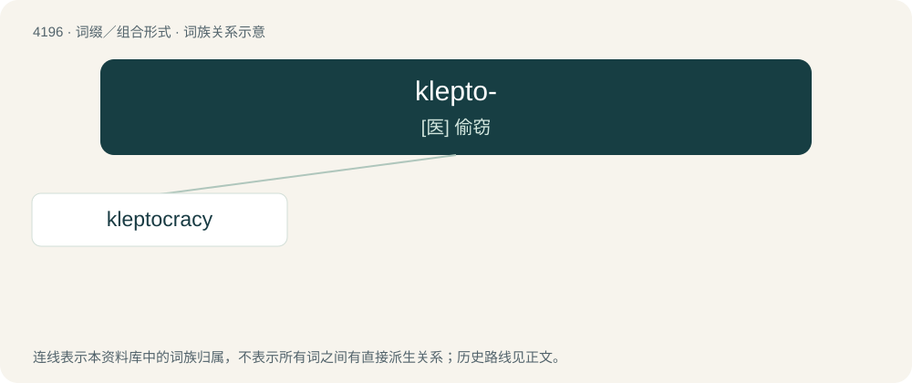

# 4204 · klepto- — \[医\] 偷窃

[总目录](../00_总目录_按常用程度.md)

**类型**：词缀／组合形式　｜　**来源语言**：见词源记录

## 核心含义与来源

- 核心含义：\[医\] 偷窃
- 英文含义：stealing, theft
- 词形：klepto-

**来源记录 1**（前缀／前置成分；stealing, theft）

Representing a combining form of Ancient Greek κλέπτης (kléptēs, “thief”), κλέπτω (kléptō, “to steal”), from Proto-Indo-European \*klep- (“to steal”). Cognate with Gothic 𐌷𐌻𐌹𐍆𐌰𐌽 (hlifan, “to steal”), Gothic 𐌷𐌻𐌹𐍆𐍄𐌿𐍃 (hliftus, “thief”).

## 词族图

## 单词速览（常用到不常用）

| 单词 | 音标 | 释义 |
|---|---|---|
| [kleptocracy](#w-1) | /klepˈtɔkrəsi/ | n. 盗贼统治(的国家) |

## 逐词详解

### 1. kleptocracy

**词性**：名词　｜　**音标**：/klepˈtɔkrəsi/

**中文释义**：n. 盗贼统治(的国家)

**英文义项**：A corrupt and dishonest government or society characterised by theft and greed.

**构词拆分**：klepto- + -cracy

**词源与演化**：

From klepto- + -cracy.

**例句**：

> Mugabe's regime did not so much slide as plunge headlong into kleptocracy.
