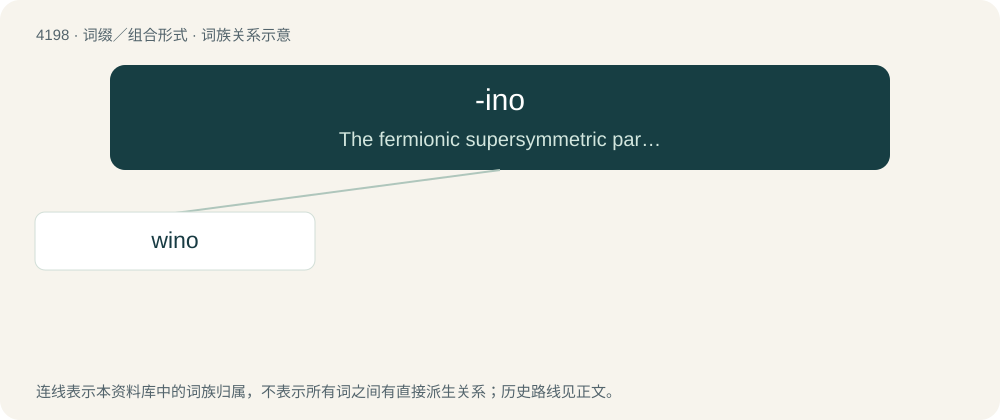

# 4206 · -ino — The fermionic supersymmetric partner of a boson (a bosino), symbolized by a tilde over the nonsupersymmetric particle symbol.

[总目录](../00_总目录_按常用程度.md)

**类型**：词缀／组合形式　｜　**来源语言**：见词源记录

## 核心含义与来源

- 核心含义：The fermionic supersymmetric partner of a boson (a bosino), symbolized by a tilde over the nonsupersymmetric particle symbol.
- 英文含义：The fermionic supersymmetric partner of a boson (a bosino), symbolized by a tilde over the nonsupersymmetric particle symbol.
- 词形：-ino

**来源记录 1**（后缀／后置成分；The fermionic supersymmetric partner of a boson (a bosino), symbolized by a tilde over the nonsupersymmetric particle symbol.）

From Italian -ino (“-ine, -o: forming diminutives”), from the dative form of Latin -īnus. In its use in physics, originally after the model of earlier neutrino, coined by Enrico Fermi in 1933. Internet slang usages gained currency in the second half of the 2010s.

## 词族图

## 单词速览（常用到不常用）

| 单词 | 音标 | 释义 |
|---|---|---|
| [wino](#w-1) | /ˈwiːnəʊ/ | 【英文】A hypothetical particle that is the superpartner of the W boson. |

## 逐词详解

### 1. wino

**词性**：名词　｜　**音标**：/ˈwiːnəʊ/

**英文义项**：A hypothetical particle that is the superpartner of the W boson.

**构词拆分**：From W-boson + -ino.

**词源与演化**：

From W-boson + -ino.
