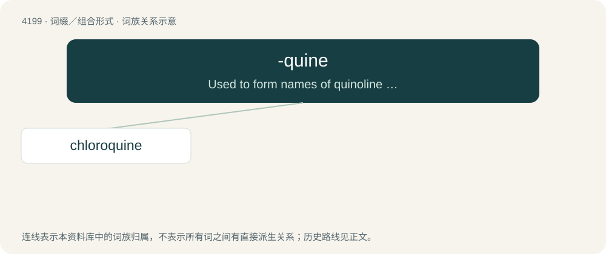

# 4207 · -quine — Used to form names of quinoline derivatives.

[总目录](../00_总目录_按常用程度.md)

**类型**：词缀／组合形式　｜　**来源语言**：见词源记录

## 核心含义与来源

- 核心含义：Used to form names of quinoline derivatives.
- 英文含义：Used to form names of quinoline derivatives.
- 词形：-quine

**来源记录 1**（后缀／后置成分；Used to form names of quinoline derivatives.）

Contraction of quinoline.

## 词族图

## 单词速览（常用到不常用）

| 单词 | 音标 | 释义 |
|---|---|---|
| [chloroquine](#w-1) | 英 /ˈklɔː.ɹə(ʊ).kwiːn/；美 /ˈklɔɹ.əˌkwɪn/ | n. 氯奎, 氯喹；\[化\] 氯喹 |

## 逐词详解

### 1. chloroquine

**词性**：名词　｜　**音标**：英 /ˈklɔː.ɹə(ʊ).kwiːn/；美 /ˈklɔɹ.əˌkwɪn/

**中文释义**：n. 氯奎, 氯喹；\[化\] 氯喹

**英文义项**：A 4-aminoquinoline drug used to treat and prevent malaria, having the chemical formula C₁₈H₂₆ClN₃.

**构词拆分**：chloro- + -quine

**词源与演化**：

From chloro- + -quine (“quinoline derivative”).

**例句**：

> Nigeria has warned against using the drug chloroquine to fight COVID-19 after three people were hospitalized after overdosing on it.
