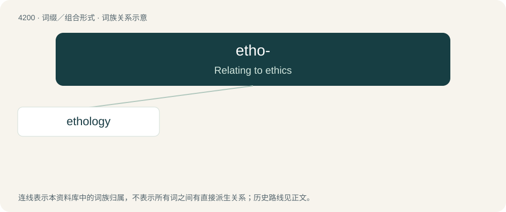

# 4208 · etho- — Relating to ethics

[总目录](../00_总目录_按常用程度.md)

**类型**：词缀／组合形式　｜　**来源语言**：见词源记录

## 核心含义与来源

- 核心含义：Relating to ethics
- 英文含义：Relating to ethics
- 词形：etho-

**来源记录 1**（前缀／前置成分；Relating to ethics）

From Ancient Greek ἦθος (êthos).

## 词族图

## 单词速览（常用到不常用）

| 单词 | 音标 | 释义 |
|---|---|---|
| [ethology](#w-1) | 英 /iːˈθɒl.ə.dʒi/；美 /ɪˈθɑl.ə.d͡ʒi/ | n. 性格学, 生态学, 特性论；\[医\] 个体生态学 |

## 逐词详解

### 1. ethology

**词性**：名词　｜　**音标**：英 /iːˈθɒl.ə.dʒi/；美 /ɪˈθɑl.ə.d͡ʒi/

**中文释义**：n. 性格学, 生态学, 特性论；\[医\] 个体生态学

**英文义项**：The scientific study of animalian behavior, especially that of nonhuman animals. / The study of the human ethos.

**构词拆分**：etho- + -logy

**词源与演化**：

From the Latin ēthologia (“the art of depicting or imitating character”), from the Ancient Greek ἠθολογία (ēthología, “painting of character, especially by mimic gestures”), from ἠθολόγος (ēthológos, “painting character by mimic gestures”), from ἦθος (êthos, “character, especially moral character”). Equivalent to etho- + -logy.

**例句**：

> In dog ethology the leader is called 'alpha'; after that it continues with 'beta' and 'gamma'.
