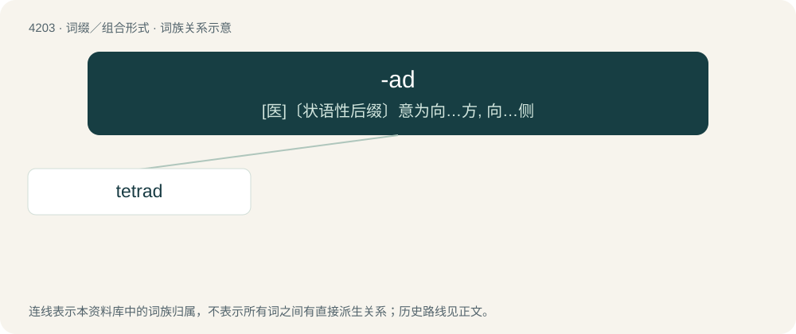

# 4211 · -ad — \[医\]〔状语性后缀〕意为向…方, 向…侧

[总目录](../00_总目录_按常用程度.md)

**类型**：词缀／组合形式　｜　**来源语言**：见词源记录

## 核心含义与来源

- 核心含义：\[医\]〔状语性后缀〕意为向…方, 向…侧
- 英文含义：A unit or set (especially of a specified number).
- 词形：-ad

**多个词源／构词路径**：同一拼写可能有不同来源；以下按词性和含义分别列出。

**来源记录 1**（后缀／后置成分；A unit or set (especially of a specified number).）

From Ancient Greek -άς (-ás) (genitive -άδος (-ádos)): a suffix forming feminine nouns.

**来源记录 2**（后缀／后置成分；toward）

Derived from Latin ad (“at”), from Proto-Italic \*ad, from Proto-Indo-European \*h₂éd. Coined by British anatomist John Barclay.

## 词族图

## 单词速览（常用到不常用）

| 单词 | 音标 | 释义 |
|---|---|---|
| [tetrad](#w-1) | 英 /ˈtɛtɹæd/ | n. 四元组, 四个一组, 四分染色体；\[计\] 四位组 |

## 逐词详解

### 1. tetrad

**词性**：名词　｜　**音标**：英 /ˈtɛtɹæd/

**中文释义**：n. 四元组, 四个一组, 四分染色体；\[计\] 四位组

**英文义项**：A group of four things. / Two pairs of sister chromatids (a dyad pair) aligned in a certain way and often on the equatorial plane during the meiosis process.

**构词拆分**：tetra- + -ad

**词源与演化**：

From Ancient Greek τετράς (tetrás), analysable as tetra- + -ad.
